# HipMRI Segmentation with a 3D Improved U-Net

This project asks whether 3D spatial context improves prostate segmentation at
target ends and adjacent-organ boundaries enough to justify its computational
cost. The main model is a **3D Improved U-Net**, compared with
an implemented slice-wise 2D U-Net on the same patients and prepared grids.

**Finding:** 3D improves prostate terminal overlap on the original frozen test,
but does not provide a consistent advantage across splits, organs and training
budgets. The 2D baseline leads the supplementary twelve-epoch CV aggregate
results and is cheaper in the measured inference benchmark.

The reported training and evaluation runs are complete. Remaining implementation
and submission items are identified below.

[One-page feasibility review (PDF)](docs/feasibility-review.pdf)

## Data and evaluation design

The HipMRI dataset contains **211 paired MRI/label scans from 38 patient groups**.
All scans of a patient stay in one partition, using the identifier before
`_Week` as the grouping key. The original split was frozen with seed 3710:

| Partition | Patients | Scans |
| --- | ---: | ---: |
| Training | 28 | 173 |
| Validation | 5 | 19 |
| Held-out test | 5 | 19 |

Grouping by patient prevents repeated weekly scans of the same person from
crossing partitions. The 28/5/5 allocation retains most patients for learning
while separating validation-based model selection from final assessment. Five
patients per evaluation partition give limited precision; supplementary CV
examines split sensitivity without adding patients to the original test.

Labels are **0 Background, 1 Body, 2 Bones, 3 Bladder, 4 Rectum, 5 Prostate**.
The source folders are `semantic_MRs` and `semantic_labels_only`; the alternative
`keras_slices_data` split is not used. The label mapping comes from the
[publisher's data description](https://data.csiro.au/dap/ws/v2/collections/52549/support/5034).

**Preparation.** Paired shapes and affine geometry are checked. Labels in the
school copy have unknown spatial units; after geometry checks, an explicit
option adopts the paired MRI's units. Each MRI is normalized using its nonzero
voxel mean and population standard deviation, then downsampled by factor 2.
Images use trilinear interpolation; labels use matched nearest-neighbor indices.
The updated affine preserves the outer field of view. Typical inputs become
`[D,H,W]=[64,128,128]`; one deeper training scan becomes `[72,128,128]`.
Axes retain source K/J/I order. No augmentation, isotropic resampling, clipping
or postprocessing was used; augmentation remains unimplemented.

Model input is float32 `[N,1,D,H,W]` and output is six-class logits
`[N,6,D,H,W]`; argmax returns `[N,D,H,W]` labels. Targets remain integer class
indices for cross entropy. `SoftDiceLoss` converts them to six-channel one-hot
masks internally, then selects foreground channels for its loss.

**Metrics.** Predictions use argmax over six classes. Dice and IoU are computed
per complete prepared volume, excluding background from the reported means:

```text
Dice = 2 TP / (2 TP + FP + FN)       IoU = TP / (TP + FP + FN)
```

If prediction and target are both empty, the score is undefined and excluded
with its valid count reported; a one-sided empty case scores zero. Scan means
weight scans equally. Patient means average within each patient first, then
weight patients equally, preventing frequent scans from dominating.

The prostate **terminal union** comprises the first and last `ceil(n/5)` of the
`n` GT-occupied source-K planes, counting complete planes once. Predictions on
GT-empty planes are counted separately. These are reproducible end-region
proxies, not anatomical base/apex annotations or physical surface distances.

Data were provided by HipMRI Study; see [Dowling and Greer](https://doi.org/10.25919/45t8-p065)
and [Dowling et al.](https://doi.org/10.1016/j.ijrobp.2015.08.045). Data-use terms
apply. MRI volumes, patient mappings, weights and raw logs are excluded from Git.

## Models and training

The main model adapts the architecture in
[Isensee et al., section 2.1](https://arxiv.org/abs/1802.10508). Its residual
encoder uses pre-activation 3D convolutions, instance normalization, LeakyReLU
and channel-wise dropout. Strided convolutions reduce resolution. The decoder
upsamples to each skip feature's exact size, concatenates the skip and fuses
features. Three 1x1x1 segmentation heads combine logits by coarse-to-fine
upsampling and addition. One loss on the summed output trains all heads;
there are no separate losses at each scale. This is an adaptation, not an
exact paper reproduction.

The [2D U-Net baseline](https://arxiv.org/abs/1505.04597) uses two convolutions
per level, instance normalization/ReLU, max pooling, transposed convolutions
and skip concatenation. It has no residual blocks, dropout or multiscale heads.
All source-K planes are batched through the same network and restored to a
volume. Its network has no learned inter-slice context, although shared
whole-volume normalization and 3D downsampling mix information during preparation.
Padded convolutions and affine instance normalization adapt the original U-Net;
this baseline is also not an exact reproduction of its reference paper.

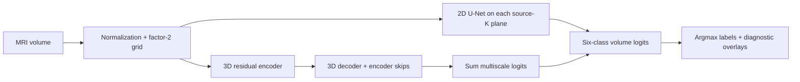

Both models use channels **16/32/64/128**, batch size one volume, Adam at
**0.001**, seed **3710**, and one optimizer update per complete case. The
objective is an equal-weight sum of voxel-mean cross entropy and foreground
soft Dice (classes 1-5, smoothing 1e-5). The 3D dropout rate is **0.3**. Cases
are shuffled using `seed + epoch`; strict deterministic mode is enabled.
Models also differ in capacity, activations and supervision, so the comparison
does not isolate the causal effect of dimensionality.

For each sample `n` and foreground class `c`, with `v` indexing spatial voxels:

```text
L = mean_voxels CE(logits, integer_target)
  + mean_(n,c=1..5) [1 - (2 sum_v p*y + e) / (sum_v p + sum_v y + e)]
```

Here `p=softmax(logits)`, `y` is the one-hot target and `e=1e-5`. Cross entropy
includes background. Empty target classes still contribute to soft Dice loss
and penalize predicted probability mass; the hard-metric exclusion rule differs.

The original runs completed eight epochs, selecting minimum validation loss
with the earliest tie; both selected epoch 8. Models, preprocessing and test
rules were frozen before the held-out evaluation. Final evaluation uses
CUDA float32, TF32 off and no autocast. A full validation replay preceded the
test; small CPU/CUDA discrepancies were retained, not treated as exact equality.

| Original 2D learning curves | Original 3D learning curves |
| --- | --- |
| 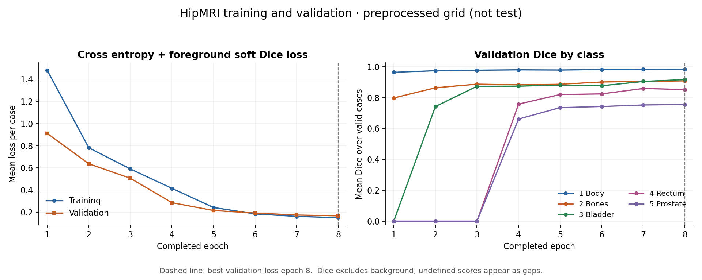 | 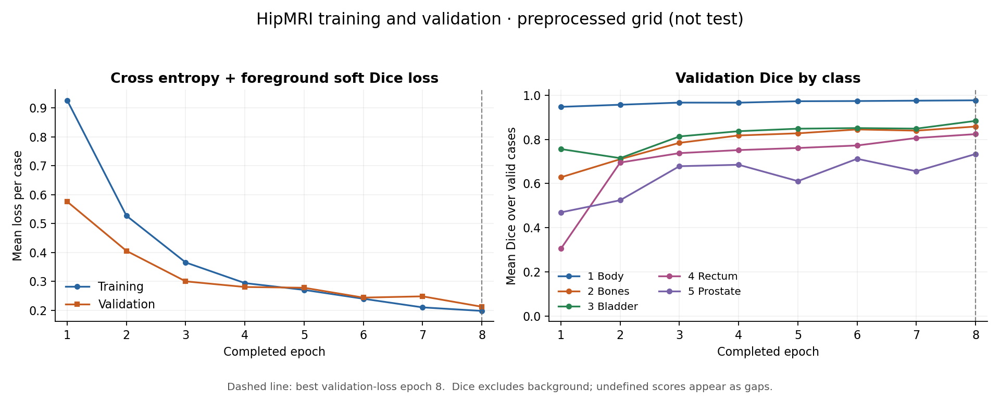 |

## Results

### Original frozen test: five patients, nineteen scans

These are scan-mean scores on the common factor-2 grid. Every foreground class
has 19 valid scans and five valid patient means.

| Class | 2D Dice | 3D Dice | 2D IoU | 3D IoU |
| --- | ---: | ---: | ---: | ---: |
| Body | 0.9838 | 0.9783 | 0.9681 | 0.9577 |
| Bones | 0.8936 | 0.8382 | 0.8078 | 0.7229 |
| Bladder | 0.9409 | 0.9066 | 0.8889 | 0.8303 |
| Rectum | 0.8226 | 0.8009 | 0.7002 | 0.6706 |
| Prostate | 0.8411 | 0.8354 | 0.7287 | 0.7188 |

Both models exceed the predeclared project target of **0.70 prostate scan-mean
Dice**. This is the project's explicit class/aggregation interpretation;
meeting it alone does not establish clinical usability or complete the assignment.

| Prostate endpoint | 2D | 3D |
| --- | ---: | ---: |
| Whole volume, patient-mean Dice | 0.8067 | 0.8242 |
| Terminal union, scan-mean Dice | 0.7342 | 0.7709 |
| Terminal union, patient-mean Dice | 0.6697 | 0.7531 |

The whole-volume ranking changes with weighting: two patients contribute
16/19 scans but only 2/5 patient weight. These are five independent patient
groups, not nineteen independent patients. In the terminal union, pooled
TP/FP/FN are **4,666/1,152/2,036** for 2D and **5,147/1,214/1,555** for 3D.
3D misses 481 fewer target voxels but adds 62 extra FP there; GT-empty planes
contain **667/815** prostate FP for 2D/3D. Its mean terminal benefit therefore
does not remove boundary errors. On the original validation CPU diagnostic,
terminal patient Dice instead favors 2D (**0.7091/0.6955**).

### Supplementary three-fold CV: sensitivity to split and training budget

CV was declared **after viewing the original test**. Only the 33 development
patients / 192 scans are used: each fold trains on 22 patients / 128 scans and
evaluates 11 patients / 64 scans. Every patient is evaluated once per model;
all their scans remain together. Both models share the same metadata-balanced,
seed-3710 folds and start fresh. The original five test patients remain excluded.

Six fixed eight-epoch runs were followed, after their results were viewed, by
four additional epochs per run with unchanged settings and restored model,
optimizer and RNG state. Reporting uses fixed epochs **8 and 12**, not each
run's best checkpoint. Fold-3 3D's bookkeeping best is 11; its endpoint remains 12.

| Prostate patient Dice | 2D epoch 8 | 3D epoch 8 | 2D epoch 12 | 3D epoch 12 |
| --- | ---: | ---: | ---: | ---: |
| Fold 1 | 0.7126 | 0.7203 | 0.7650 | 0.7504 |
| Fold 2 | 0.6362 | 0.6818 | 0.7637 | 0.7668 |
| Fold 3 | 0.7500 | 0.7192 | 0.7684 | 0.7467 |
| All 33 out-of-fold patients | 0.6996 | 0.7071 | 0.7657 | 0.7546 |

At epoch 12, all five classes have valid scores for 192 scans / 33 patients.
The following gives each patient equal weight:

| Class | 2D Dice | 3D Dice | 2D IoU | 3D IoU |
| --- | ---: | ---: | ---: | ---: |
| Body | 0.9795 | 0.9741 | 0.9601 | 0.9498 |
| Bones | 0.8904 | 0.8627 | 0.8032 | 0.7601 |
| Bladder | 0.8831 | 0.8494 | 0.8099 | 0.7714 |
| Rectum | 0.8174 | 0.8040 | 0.6952 | 0.6772 |
| Prostate | 0.7657 | 0.7546 | 0.6271 | 0.6160 |

Both models improve every foreground class's aggregate Dice/IoU from epoch 8
to 12. The 2D model has the larger prostate improvement and leads every class
at epoch 12 under scan and patient weighting. Prostate scan Dice is
**0.7762/0.7589**. Prostate patient Dice improves for **27/33**
patients in 2D and **23/33** in 3D; 2D wins the final paired comparison for
22 patients, 3D for 11. The mean difference (3D minus 2D) is **-0.01107**.

The [six complete CV learning curves](figures/cv12-learning-comparison.png)
retain every epoch. One seed, overlapping training folds and a continuation
chosen after viewing results do not establish statistical superiority or
convergence. Each fold has fewer training patients than the original experiment,
and evaluates different people. These scores neither replace nor enlarge the
original test; CV12 has not been evaluated on that test cohort.

### Measured computational cost

The historical **epoch-4** benchmark used one A100-PCIE-40GB, float32 prepared
`[64,128,128]` volumes and fresh-process order 2D/3D/3D/2D. Each block covered
19 validation scans with five warmups and ten synchronized repeats per scan.
Time is the median of case medians; memory is the maximum allocated tensor peak.

| Measurement | 2D | 3D | 3D / 2D |
| --- | ---: | ---: | ---: |
| Trainable parameters | 482,422 | 2,349,986 | 4.87x |
| Median forward time per volume | 13.36 ms | 49.96 ms | 3.74x |
| Peak allocated tensor memory | 445.89 MiB | 565.98 MiB | 1.27x |

These measurements exclude loading, preprocessing, transfer and postprocessing;
they are not end-to-end latency or training memory. Loading/preparation averaged
1.68-1.76 seconds across blocks. Some 2D case timings varied between blocks,
and GPU clocks were not locked. This benchmark was not repeated at epoch 8/12.

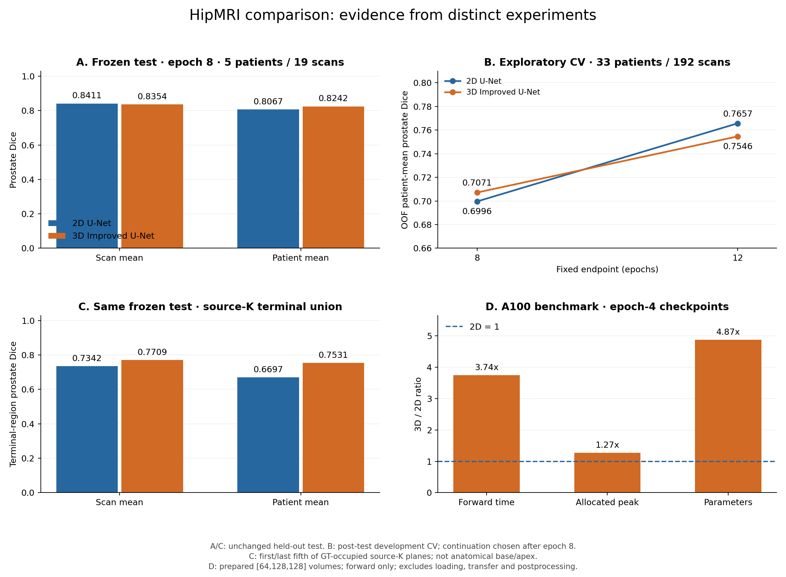

## Five paired failure-case analyses

The following are **original epoch-8 CPU validation predictions**, not CV12 or
formal-test images. Examples 2-6 cover five different validation patients.
Examples 2-5 were selected from early 3D scores to include difficult and strong
cases; example 6 was added from epoch-4 scores as the worst 3D prostate case.
Cases and ground-truth-selected planes were held fixed through epoch 8. This
purposeful selection illustrates failure types, not their population frequency.

Each panel contains MRI, ground truth, prediction and error overlays. In error
columns, **green=TP, magenta=FP, cyan=FN**, not confidence. Depth `d` follows
source K; counts are prepared-grid voxels. Paired images share geometry and
display windows and are unchanged server outputs. Open them for full-size labels.

### 1. Example 2: shared terminal omission and bladder undercoverage

At `d=23`, both models miss all **35** prostate target voxels. At the largest
bladder plane, FN are **546/1,123** for 2D and **856/1,123** for 3D; whole-volume
bladder Dice is **0.5646/0.3633**. Both also predict rectum on a GT-empty plane
(29/40 FP). Added context has not prevented these errors. The small terminal
target motivates a resolution-sensitivity experiment, but downsampling is an
untested explanation. Review target disappearance and bladder coverage separately;
slice-level extra regions do not prove disconnected three-dimensional components.

| 2D | 3D |
| --- | --- |
| 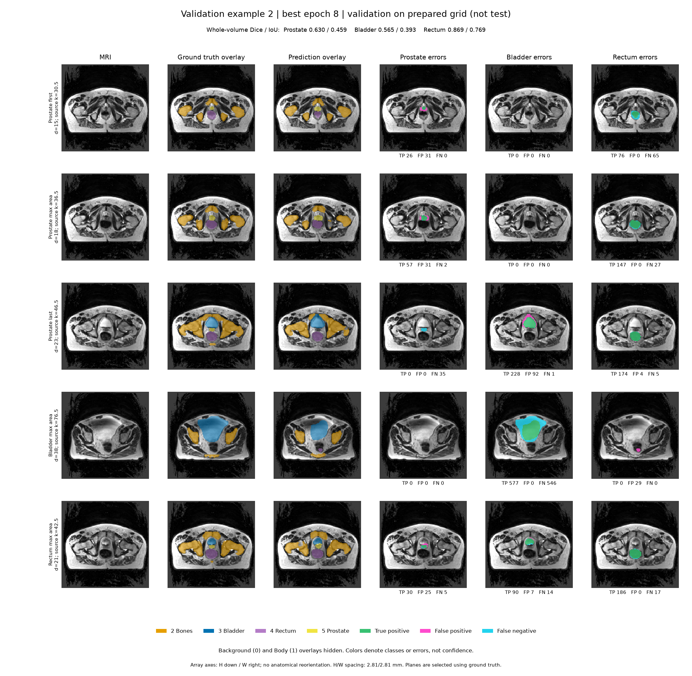 | 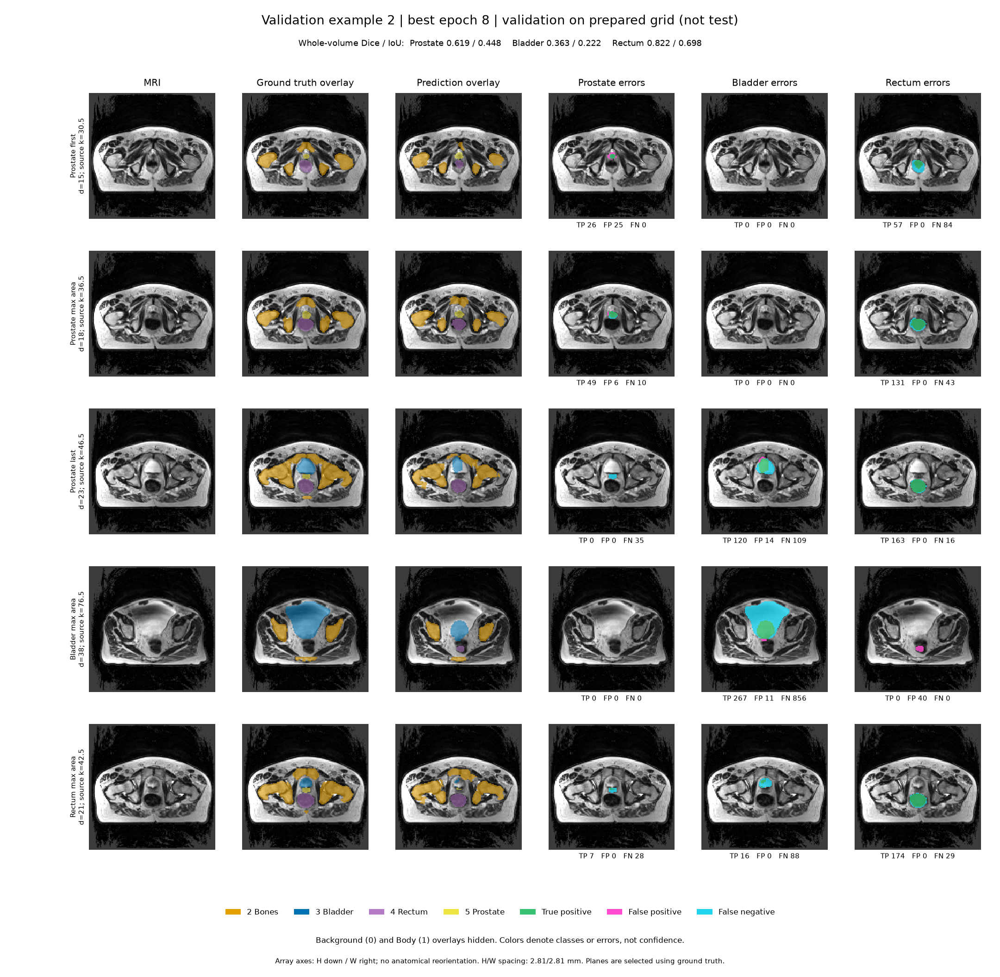 |

### 2. Example 3: whole-volume improvement conceals a worse terminal region

Prostate Dice favors 3D (**0.8030/0.8150**), while terminal-union Dice favors
2D (**0.8278/0.7702**). On the last plane, 2D finds **0/22** target voxels and
3D only **4/22**, with 11 FP. The larger central plane improves from 69/120 to
97/120 detected voxels. Global Dice pools voxel counts, so central gains can
outweigh small end errors. Even a terminal-region mean can conceal a missed
individual plane; inspect both aggregate scores and consecutive target ends.

| 2D | 3D |
| --- | --- |
| 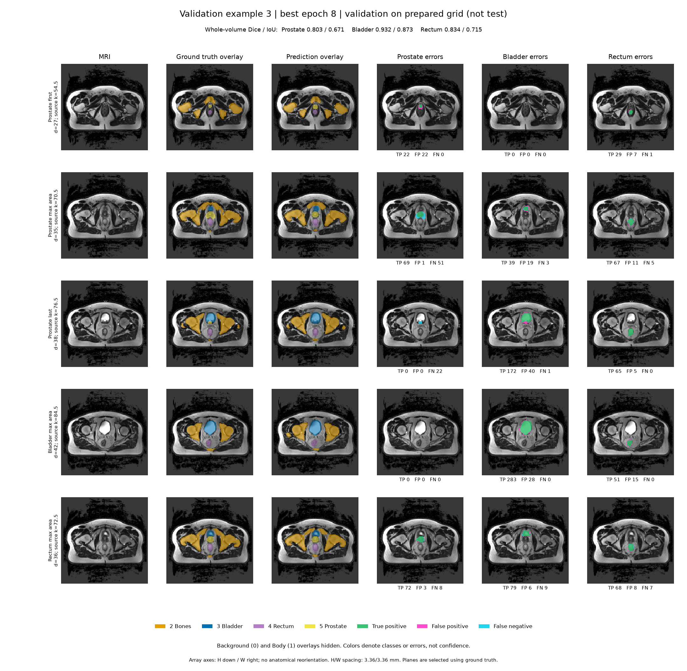 | 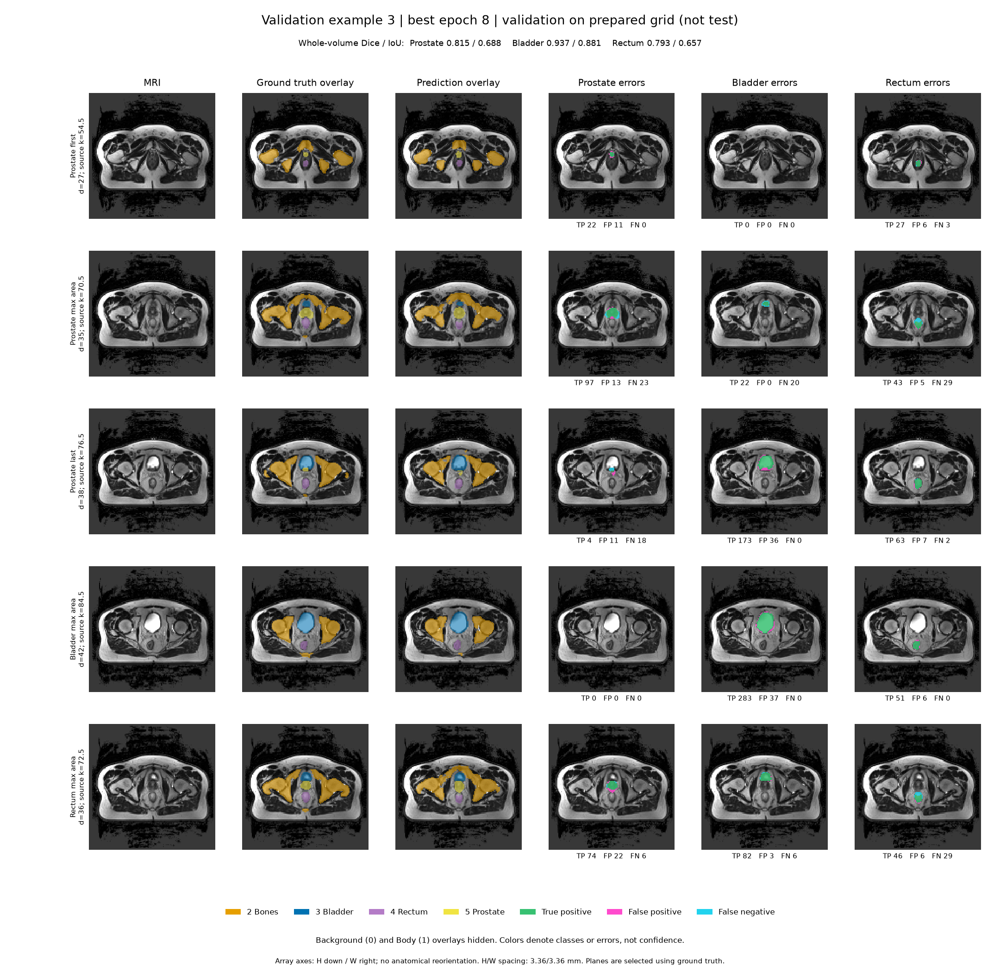 |

### 3. Example 4: similar Dice hides opposite FP/FN trade-offs

Whole-prostate Dice is almost equal (**0.8880/0.8889**), but FP are **234/119**
and FN **59/149** for 2D/3D. On the first labelled plane, 2D finds **33/44**
target voxels versus **11/44** for 3D. Higher 3D precision accompanies lower
recall: a smaller contour reduces excess while losing target. This explains
why Dice alone cannot choose the preferable error pattern; it does not prove
which architectural component caused the shrinkage. Review end-plane FN even
when whole-volume overlap is high.

| 2D | 3D |
| --- | --- |
|  | 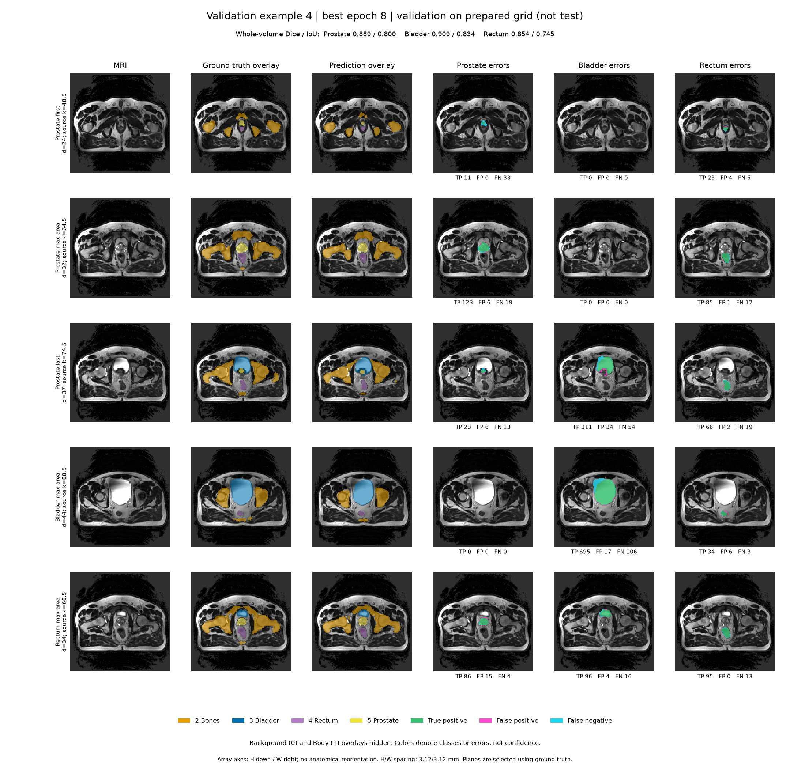 |

### 4. Example 5: local 3D benefits coexist with errors elsewhere

Whole-prostate Dice is **0.7525/0.7493**, yet 3D improves terminal Dice
**0.6154/0.6950** and finds 18/18 rather than 12/18 target voxels on the last
plane. It also recovers 11/19 rectum voxels where 2D finds none. However,
prostate FP on GT-empty planes rise **51 to 122**, and bladder Dice falls
**0.9426 to 0.8916**. A contextual benefit is plausible but not isolated from
architecture changes. Check neighboring organs and the full target extent;
local recovery does not justify declaring the entire case improved.

| 2D | 3D |
| --- | --- |
| 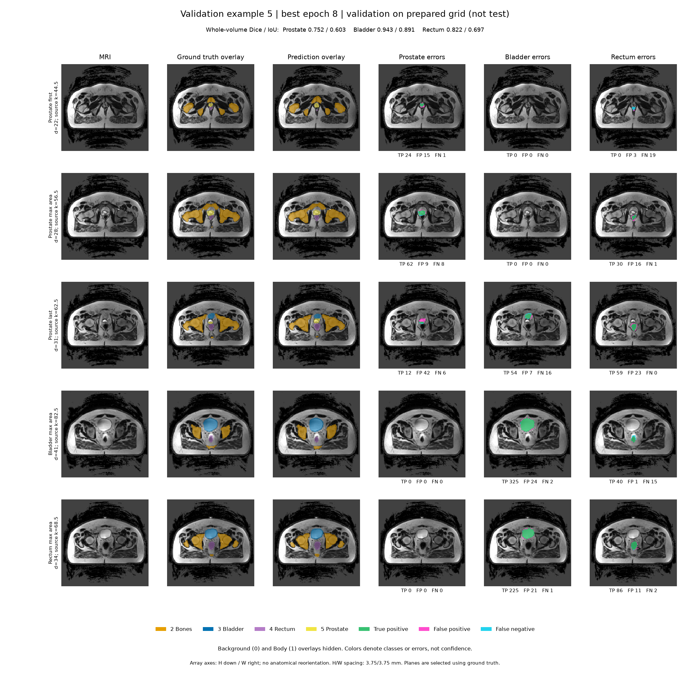 |  |

### 5. Example 6: high recall with substantial prostate overextension

Of 503 prostate voxels, 2D finds **501** and 3D **502**, but FP are **363/747**;
Dice is **0.7330/0.5731**. The 3D excess overlaps 602 Body, 92 bladder and
53 rectum target voxels, and adds 16 prostate FP on a plane with no prostate GT.
From epoch 4 to 8 its FN fell 57 to 1 while FP stayed near 744-747. More
training improved coverage without removing overextension. Adjacent-label
confusion is observed; its cause is unproven. Review these interfaces and test
any proposed correction on development data before claiming improvement.

| 2D | 3D |
| --- | --- |
| 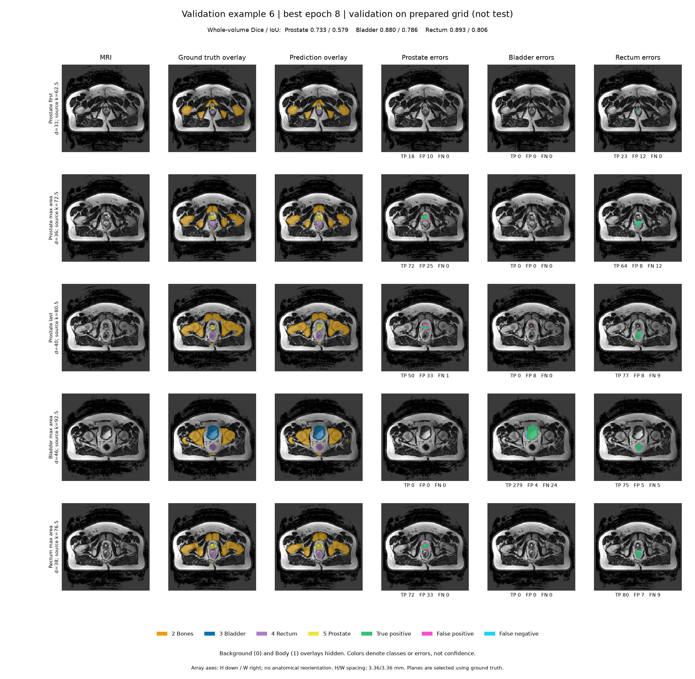 | 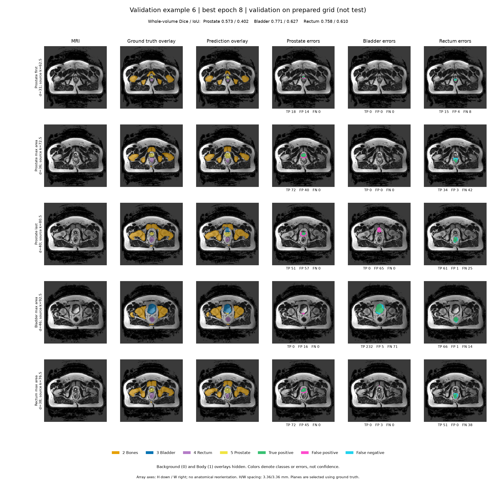 |

## Engineering recommendation and limitations

Use **2D as the practical efficiency baseline** for this research prototype:
it leads the CV12 aggregates and costs less in the measured forward benchmark.
Retain **3D Improved U-Net as the main investigation**, with its original-test
terminal benefit reported alongside its inconsistent gains elsewhere. There
is insufficient evidence to justify replacing 2D universally to gain 3D context.

Both models still need human correction for target-end omissions, bladder
undercoverage and prostate overextension. These retrospective GT comparisons
are not an automatic failure detector or validated clinical workflow. Clinical
safety and correction time were not measured. Five test patients, one seed,
architecture confounds and factor-2 resolution limit generalization. Native-grid
accuracy, physical surface distances and 3D connected components remain unmeasured.
The validation panels cannot establish the cause of the CV12 ranking.

A plain-3D ablation, resolution comparison or targeted loss/augmentation study
could isolate candidate causes in future development experiments. None was
performed here. Original test results remain fixed; further work must not use
that cohort to select changes.

## Running the project

Run commands from this directory with authorized data and frozen manifest/split
files. GPU work belongs on an allocated compute node. The measured Rangpur
environment was Python **3.11.15**, PyTorch **2.13.0+cu130**, NumPy **2.4.6**,
NiBabel **5.4.2**, CUDA **13.0**, cuDNN **9.20.0**, driver **590.48.01**.
Prediction PNG metadata records Matplotlib **3.11.2**; local report figures used
**3.10.0**. `python -s` excludes conflicting user-site packages.
[Detailed setup and commands](docs/reproduction.md) cover
data preparation, both training entries, checkpoint restoration, prediction,
frozen evaluation and the benchmark.

```bash
# Fresh original 3D recipe; data files are private prerequisites.
python -s train.py --manifest private/manifest.json --split private/split.json \
  --output-dir private/repro-3d --epochs 8 --device cuda \
  --deterministic --assume-label-units-from-image

# Load trained weights and render a validation example.
python -s predict.py --run-dir private/repro-3d \
  --manifest private/manifest.json --split private/split.json \
  --case-ids VALIDATION_CASE_ID --output-dir private/prediction-example \
  --device cpu --threads 1 --repeats 1 --terminal-regions --include-rectum-panels

# Inspect code mechanics using synthetic data, without the HipMRI dataset.
python -s -m unittest discover -s tests -v
```

Replace `VALIDATION_CASE_ID` with an ID in the frozen validation list. Prediction
exports PNG panels and `prediction.json`; input/output examples appear above.

The training run saves `run.json`, `history.csv` and latest/best checkpoints.
`predict.py` loads the best checkpoint for validation examples; `evaluate.py`
provides a guarded full-validation rehearsal and held-out entry. CV endpoints
instead use saved epoch-8/12 evaluation histories. Private fold assignments,
historical orchestration and weights are not distributed, so the public repo
alone is not a one-command reproduction of the archived CV runs. Synthetic
tests check shapes, losses, grouping, resume and evaluation safeguards; they
do not establish real-data accuracy or clinical suitability.

## Feasibility review

**Project aim.** My project tests whether a 3D Improved U-Net improves prostate segmentation at difficult end regions compared with a 2D U-Net, and whether better results are worth the extra computing cost. The output is a draft organ outline for a person to check.

**Method and course concepts.** The main model is a 3D Improved U-Net: 3D residual units, encoder-decoder skip connections and deep supervision that adds predictions from different scales. Course concepts include convolutions, normalization and gradient-based learning. For both models, data preparation halves the depth, height and width (downsampling factor: 2). Encoder feature channels by level: 16, 32, 64, 128; batch size: 1 MRI volume; Adam learning rate: 0.001; random seed: 3710; loss: equal-weight cross entropy plus foreground Dice. The 3D dropout probability is 0.3. Model reference: Isensee et al., arXiv:1802.10508 (task reference [2]).

**Success criteria:**

1. Keep patients separate across training: 28 patients, 173 scans; validation: 5 patients, 19 scans; test: 5 patients, 19 scans. Save checked inputs, settings, file hashes and model checkpoints.
2. Target original test prostate scan-mean Dice >= 0.70 using the same prepared image grid; report all foreground Dice/IoU and patient means. Select the checkpoint with the lowest validation loss; choose the earliest if tied. This is how I apply the task's Dice target.
3. Use the same data splits and image grids. Compare end regions (source-K terminal fifths) and errors between nearby classes. These regions approximate the ends; they are not confirmed anatomical base/apex labels.
4. Use <= 4 GiB peak allocated tensor memory and <= 2 seconds median forward-pass time across scans after warm-up per prepared volume on one A100; measure preparation separately.
5. Compare 3-5 failure cases side by side, including end-region errors and separate predicted pieces. Recommend a model based on quality and cost. Five cases are shown; separate pieces in 3D still need checking.

**Current results.** Original fixed test (epoch 8): 5 patients, 19 scans; prostate scan-mean Dice 2D: 0.8411; 3D: 0.8354, meeting the project target. Patient-mean Dice is 2D: 0.8067; 3D: 0.8242; terminal-union patient-mean Dice is 2D: 0.6697; 3D: 0.7531. Scan means give more weight to patients with more scans. The 3D advantage at the ends does not appear in every split: original validation terminal patient-mean Dice is 2D: 0.7091; 3D: 0.6955 (checked on CPU).

Additional three-fold cross-validation leaves out the five test patients: 33 development patients, 192 scans, with 22 patients training and 11 evaluated per fold. Prostate patient-mean Dice improves from epoch 8 (2D: 0.6996; 3D: 0.7071) to epoch 12 (2D: 0.7657; 3D: 0.7546). At epoch 12, 2D has higher overall scores for all five foreground classes. Cross-validation ran after the original test. We chose longer training after seeing the epoch-8 cross-validation results. These extra experiments do not replace or expand the original test.

Earlier speed and memory test (epoch 4, same A100): median forward time 2D: 13.36 ms; 3D: 49.96 ms; allocated memory peak 2D: 445.89 MiB; 3D: 565.98 MiB. Prepared volume dimensions (depth, height, width): 64 x 128 x 128 voxels. Both meet the speed and memory targets. Times exclude data preparation, transfer and output processing. These measurements are not for the epoch-12 cross-validation models or memory used during training. Five pictured epoch-8 CPU validation cases show missed end regions, missed parts of the bladder and extra areas labelled as prostate; they are not from epoch-12 cross-validation or the test set.

**Limits, next steps and backup plan.** Limits include five test patients, one seed, similar scans from the same patient, shared training patients across folds, model design differences, downsampling and small CPU/CUDA differences. Next, I plan to rerun the fixed epoch-8 validation predictions and count separate 3D pieces and wrongly predicted islands: one CPU job limited to 15 minutes, 0 additional GPU minutes, no retraining. I also plan to run more training and evaluation tasks for both the 2D and 3D models to compare segmentation quality and result stability. These tasks have not started; computing time limits will be set before submitting the jobs. I would keep 2D as the faster backup and 3D as the main model being studied. Better results in some regions do not mean 3D is always better.

## Code structure

| Files | Purpose |
| --- | --- |
| `modules.py`, `baseline2d.py` | Main 3D model and slice-wise 2D baseline |
| `dataset.py`, `objectives.py` | Pairing, patient splits, preparation, loss and metrics |
| `train.py`, `train_baseline2d.py`, `checkpoint.py` | Training, validation and resumable model/optimizer/RNG state |
| `predict.py`, `prediction_panels.py`, `terminal_regions.py` | Validation predictions, paired panels and regional errors |
| `evaluate.py` | Frozen-plan validation replay and held-out evaluation |
| `benchmark_gpu.py`, `benchmark_inference.py` | Matched forward-time/memory measurement |
| `plot_history.py`, `tests/` | Learning curves and synthetic correctness checks |

Section 4.1 of the specification requests augmentation in `dataset.py` and test
usage through `train.py`/`predict.py`. Augmentation is not implemented here;
held-out evaluation currently resides in `evaluate.py`. These implementation
alignment items remain open, alongside the unverified 3D disconnection analysis.

The final submission requires the working project PR to the course repository's
`topic-recognition` branch and a PDF export of this report for Turnitin, plus
the recorded tutor check-off. This local report update is not final submission.
Keep meaningful progressive commits and respond to the teaching team's later
PR review within its announced response window; these are separate assessed items.

## Artificial Intelligence Usage Disclosure

OpenAI Codex assisted with task interpretation, model/data/loss implementation,
tests, GitHub setup, remote experiment scripts and execution, result aggregation,
figures, feasibility material and report writing. Its role included substantive
code and experimental assistance, not only editing prose. Checks included
synthetic tests, small real-data execution/resume diagnostics, patient-separation
and source/hash checks, independent recomputation of recorded metrics, and
visual review of prediction panels. Failed runs and CPU/CUDA discrepancies were
preserved. These checks do not prove clinical validity or replace student review.
The student remains responsible for understanding and defending the submitted
code, decisions and claims.

## References

- Supplied COMP3710/COMP7710 report specification, sections 2.2-6 (filename v2.3;
  cover DRAFT/Version 2.2). Course announcements govern any revised requirements.
- Isensee et al., [Brain Tumor Segmentation and Radiomics Survival Prediction:
  Contribution to the BRATS 2017 Challenge](https://arxiv.org/abs/1802.10508).
  Main architecture reference, especially section 2.1.
- Ronneberger et al., [U-Net: Convolutional Networks for Biomedical Image
  Segmentation](https://arxiv.org/abs/1505.04597). Baseline topology reference.
- Dowling and Greer, [Labelled weekly MR images of the male pelvis](https://doi.org/10.25919/45t8-p065),
  CSIRO Data Access Portal; [dataset label description](https://data.csiro.au/dap/ws/v2/collections/52549/support/5034).
- Dowling et al., [HipMRI study publication](https://doi.org/10.1016/j.ijrobp.2015.08.045).
- PyTorch [interpolation](https://docs.pytorch.org/docs/2.14/generated/torch.nn.functional.interpolate.html)
  and [reproducibility](https://docs.pytorch.org/docs/2.14/notes/randomness.html)
  documentation, for preparation conventions and deterministic execution limits.
