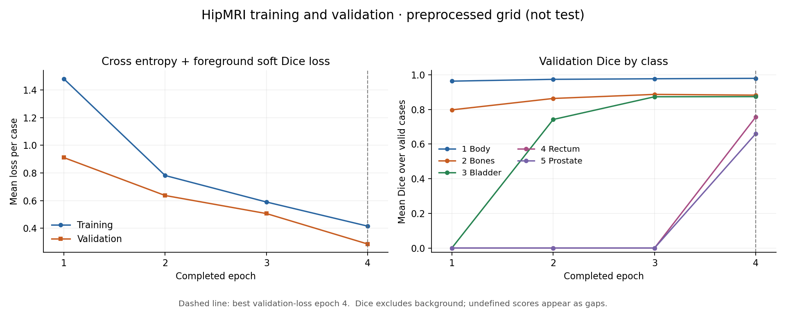
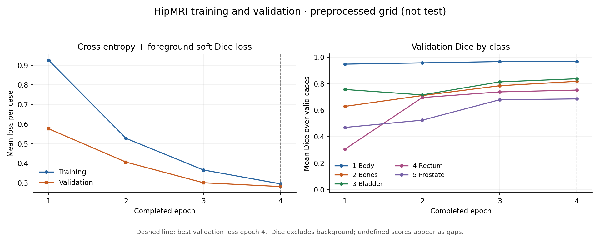
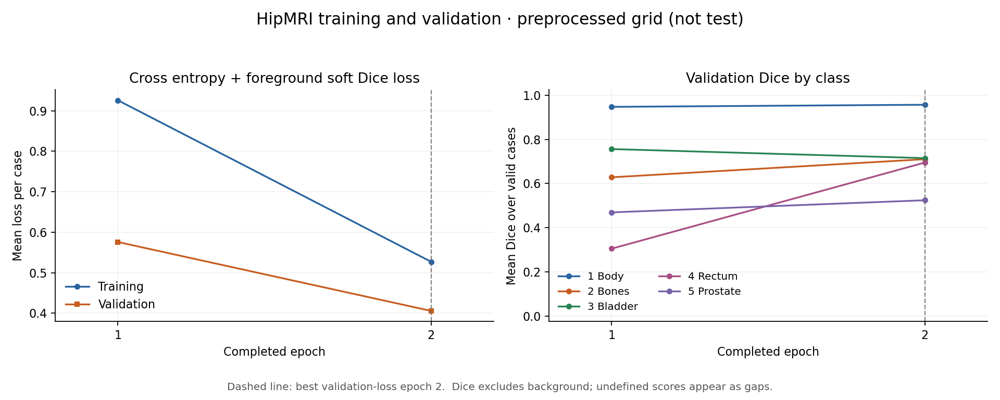

# HipMRI Segmentation with a 3D Improved U-Net

**Status: four-epoch 2D/3D pilots, terminal diagnostics and matched A100 inference benchmark completed; final comparison and held-out evaluation pending.**
`modules.py` connects the residual encoder, skip-connected decoder and multi-scale
segmentation heads. `objectives.py` adds a soft Dice loss and per-class Dice/IoU,
checked with synthetic inputs and labels. `dataset.py` validates case manifests,
groups scans into patient-level splits, reads native-grid NIfTI pairs and prepares
normalized, downsampled volumes while preserving their outer field of view.
`train.py` connects lazy case loading to multi-epoch training, validation,
model selection, logs and resumable checkpoints. Checks are separate in `tests/`.
Strict deterministic mode passed a two-training-case/one-validation-case CUDA
continuation diagnostic; this is not a formal accuracy experiment.
The subsequent 173-training-scan/19-validation-scan pilot completed successfully;
epoch-2 case-mean prostate validation Dice was 0.5243 on the factor-2 grid.
The selected checkpoint has also produced private diagnostic panels for five
validation patients. A slice-wise 2D U-Net and its resumable training command are
implemented. Both models subsequently resumed from epoch 2 to epoch 4 under
unchanged settings. The 2D model's zero prostate/rectum validation overlap at
epoch 2 became positive in all 19 validation scans at epoch 4. Prostate Dice
at epoch 4 is 0.6611 / 0.6851 for 2D / 3D by scan mean, and 0.5568 / 0.6793
when each validation patient has equal weight. Longer comparisons and held-out
test evaluation are still pending. Fixed source-K terminal-region diagnostics
now cover all 19 validation scans for both epoch-4 checkpoints, with separate
scan and patient summaries. A same-GPU forward benchmark measured cohort-median
latencies of 13.36 ms / 49.96 ms and peak allocated tensor memory of
445.89 MiB / 565.98 MiB for 2D / 3D, excluding data preparation and postprocessing.
The source-data audit, frozen patient split and preprocessing checks
are recorded below. No completed final comparative evaluation or completed
feasibility check-off are claimed.

## Proposed problem and approach

The project will investigate whether volumetric context improves prostate
segmentation at the base, apex and adjacent-organ boundaries enough to justify
its memory and inference cost. The intended prototype would produce contours
for human review.

The proposed main model is a PyTorch 3D Improved U-Net with residual units and
deep supervision on downsampled HipMRI volumes. The supplied assignment lists
this configuration as Hard difficulty. The architecture and compute budget will
be finalized after a data and resource audit.

## Planned experiments

- Train the implemented 2D U-Net baseline and proposed 3D model under a declared
  comparison budget. Use the same held-out patients and evaluate both on
  consistently reconstructed case volumes.
- If resources permit, add a plain 3D U-Net comparison to separate the effect of
  volumetric context from the effect of the architectural improvements.
- Report per-class Dice and IoU, parameter count, peak GPU memory and per-case
  inference time. Define model selection and evaluation before using the test set.
- Inspect 3-5 representative failures using input images, ground-truth masks,
  predictions and false-positive/false-negative overlays.
- Use the measured results to recommend where the prototype is useful, where
  human correction remains necessary and whether its additional cost is justified.

These are planned experiments, not completed work or assumed improvements.

## Development milestones

1. Confirm access to Rangpur GPU resources and the HipMRI data. A small CUDA
   forward/backward/optimizer check passed on 15 October 2026. The data directories
   at `/home/groups/comp3710/HipMRI_Study_open` are readable; the data audit below
   records the checks completed so far.
2. Audit patient identifiers, image/label pairs, label meanings, voxel spacing,
   orientation and spatial alignment.
3. Group all scans from each patient into one train/validation/test partition
   before constructing slices or patches. The split is frozen at 28/5/5 patients
   (173/19/19 scans), with seed 3710; assignments are retained outside Git.
4. Implement and run a small baseline experiment, measuring actual memory and time.
5. Prepare the one-page feasibility review: user need, 3-5 testable acceptance
   criteria, initial evidence, resource budget, risks and a fallback. Complete
   the required tutor check-off by the published course midpoint.
6. Implement the main model, run the comparisons and analyze failure cases.
7. Complete the report, reproduction instructions and final submission.

## Feasibility review - draft for tutor consultation

**16 October 2026. Tutor check-off: not completed, as confirmed by the student.**
This written review is ready for the required practical discussion. The course
requires it before extensive computing; preparing this draft does not complete
the hurdle. The next budget below is proposed, not tutor-approved or submitted.

**User need and scope.** Imaging researchers and specialist reviewers need
MRI contour drafts with visible errors. This prototype asks whether 3D context
improves prostate terminal regions enough to justify its cost over 2D U-Net.
Contours require human review; clinical suitability and time savings are unproven.

**Five proposed acceptance criteria, fixed before held-out evaluation:**

1. Keep the patient-disjoint 28/5/5-patient split (173/19/19 scans), validate
   training/validation inputs, and retain configurations, hashes and checkpoints.
2. Target held-out case-mean prostate Dice of at least 0.70 on the common factor-2
   grid. Report all foreground Dice/IoU, valid counts and patient-macro summaries;
   select checkpoints by minimum validation loss, with the earliest tie.
3. Compare both models on the same split/grid, including the fixed first/last
   20% of prostate-bearing source-K planes and adjacent-class confusion. State
   whether 3D improves the quality/cost trade-off; source-K ends are not anatomical
   base/apex labels or proof of boundary safety.
4. Use at most 4 GiB peak allocated GPU tensor memory and a two-second
   cohort-median forward time per prepared case on one A100. Measure warmed,
   synchronized forwards and report loading/preprocessing separately.
5. Include 3-5 failure autopsies with image, label, prediction and FP/FN panels,
   covering terminal errors and disconnected predictions, then give a scoped
   engineering recommendation with remaining limitations.

**Model and course concepts.** The Hard-difficulty 3D Improved U-Net combines
residual blocks, skip connections and summed multiscale supervision. It applies
convolutional context, normalization and gradient optimization with cross entropy
plus foreground soft Dice. Both models use channels 16/32/64/128, batch one,
Adam 0.001 and seed 3710. The 3D model uses dropout 0.3; the plain 2D baseline
has different capacity and blocks, so this comparison cannot isolate 3D context.

**Preliminary evidence.** Geometry and pairing were audited for all 211 scans;
all 192 training/validation volumes passed preprocessing. The local suite passes
131 tests. Both models completed four epochs (692 updates each). Prostate
validation Dice is 0.6611/0.6851 for 2D/3D by scan mean and 0.5568/0.6793 by
patient mean. CPU terminal-union Dice is 0.6266/0.6462; 3D improves 8/19 scans
but produces more false positives. These diagnostics retain small CPU/CUDA
metric differences. The matched A100 benchmark measured 13.36/49.96 ms median
forward time and 445.89/565.98 MiB peak allocated memory, excluding preparation
and postprocessing. Both meet the proposed resource limits on this validation
grid; two 2D blocks show variable per-case timing. Five validation patients,
one seed and four epochs do not establish convergence or held-out quality.

**Risks, next experiment and fallback.** Risks are class imbalance, downsampling
of small structures, correlated scans, architecture confounds and GPU queues.
Discuss a fixed continuation from epoch 4 to 8 for each model, restoring
model/Adam/RNG and changing no other settings. Recent epochs imply about
22/23 minutes for 2D/3D, with separate 30-minute caps (60 GPU-minutes total);
queue time and later evaluation are extra. Stop at epoch 8 or failure/time cap,
without automatic extension. Report both validation-selected and epoch-8 results
before choosing the final protocol. Complete tutor check-off before extensive
experiments and freeze evaluation rules before opening held-out test voxels.
If resources fail, retain the 2D baseline; a narrower 3D model would be a separate,
newly declared experiment. Keep failed runs and original epoch-4 controls.

## Code structure

| File | Responsibility | Current state |
| --- | --- | --- |
| `modules.py` | PyTorch model components | Residual encoder, decoder, segmentation heads and summed-output deep supervision |
| `baseline2d.py` | 2D U-Net comparison model | Shared slice-wise network with full-volume input/output; no learned cross-slice operations |
| `objectives.py` | Segmentation loss and overlap metrics | Soft Dice loss and per-volume Dice/IoU |
| `dataset.py` | Loading, preprocessing, patient splits and augmentation | Manifest and frozen-split validation, strict NIfTI loading, normalization, matched downsampling and lazy single-case batches; augmentation pending |
| `train.py` | Training and validation | Multi-epoch command, validation-loss model selection, resumable state and metrics JSON/CSV; held-out testing pending |
| `train_baseline2d.py` | 2D training command | Whole-case objective and optimizer steps, shared data preparation/metrics, architecture-tagged resumable checkpoints |
| `plot_history.py` | Learning-curve export | Validates saved run metrics and exports loss/per-class validation Dice to PNG or PDF |
| `checkpoint.py` | Save and restore training state | Epoch-boundary model/optimizer/configuration/progress and RNG persistence |
| `predict.py` | Inspecting 2D/3D checkpoints on validation scans | Architecture/source binding, prepared-grid prediction, six-class voxel counts/confusion, saved-metric comparison and limited inference timing; held-out testing pending |
| `prediction_panels.py` | Rendering private prediction diagnostics | Fixed ground-truth slice selection with prostate/bladder errors and optional rectum plane/error column |
| `terminal_regions.py` | Prostate terminal-region diagnostics | Fixed source-K terminal fifths, whole-plane errors, outside-target FP and separate scan/patient summaries |
| `benchmark_gpu.py` | Frozen-checkpoint GPU benchmark entry | Full-validation/source binding, explicit precision policy, device telemetry and private per-case results |
| `benchmark_inference.py` | Forward timing and memory measurement | Warmed synchronized wall/event timing, forward-only allocated peaks and case/patient summaries |
| `tests/` | Synthetic checks using standard-library `unittest` | Model, objective, data preparation, epoch functions, checkpoints and end-to-end runner tests |

This README will develop into the final technical report. Training and validation
inspection commands are documented below; final held-out evaluation is pending.

## Model components

`ResidualBlock3D` accepts `[N, C, D, H, W]` feature tensors and preserves spatial
dimensions. It uses two pre-activation 3D convolutions with instance normalization
and LeakyReLU, inspired by the context modules described by Isensee et al. The
project uses configurable channel-wise dropout and a 1x1x1 shortcut projection
when the channel count changes. This is a building block, not a claim of a full
paper reproduction.

`Encoder3D` applies a full-resolution stem and residual block, then uses stride-two
3D convolutions and residual blocks to form a feature pyramid. It returns a tuple
from highest resolution to bottleneck, retaining earlier features for decoder
skip connections. Each downsampled axis has size `ceil(n / 2)`; input
dimensions need not be divisible by powers of two. A bottleneck containing only
one spatial voxel is rejected before computation because instance normalization
cannot use it. Thin volumes with more than one voxel at the bottleneck are allowed.

`DecoderBlock3D` resizes a lower-resolution tensor to its skip's exact spatial
shape using nearest-neighbor interpolation. A 3x3x3 convolution adjusts its
channels, then the result is concatenated with the skip. A 3x3x3 convolution and
a 1x1x1 convolution fuse the features and reduce the concatenated channel count,
with instance normalization and LeakyReLU. This follows the localization-pathway
idea in the reference paper, extending the resizing to support odd input sizes.

`Decoder3D` consumes the entire encoder feature tuple and checks its level count,
channels, batches and adjacent spatial sizes. It returns decoded features from
highest to lowest resolution, excluding the consumed bottleneck. Output level
`i` matches encoder level `i` in spatial size and channels. At least two encoder
levels are required; a single-level encoder has no decoding stage. For four
encoder levels, three decoder features are returned for the segmentation heads.

The default widths `(16, 32, 64, 128)` and dropout probability `0.3` are configurable
starting points, not settings selected through HipMRI experiments.

`SegmentationHead3D` uses a 1x1x1 convolution to convert features into raw class
scores (logits). `DeepSupervisionHead3D` applies one such head to each decoder
level and combines their scores from coarse to fine. At each step, it resizes
the accumulated scores to the next finer feature's exact spatial dimensions
using nearest-neighbor interpolation, then adds that level's scores. Resizing
is performed between adjacent levels; for odd dimensions this can differ from
resizing every coarse output directly to the highest resolution.

This follows the elementwise-summed segmentation layers described in
[Isensee et al., section 2.1](https://arxiv.org/pdf/1802.10508). A loss on the
combined output supplies gradients to every head. This version does not add
separate losses at individual scales. Using every decoder level and exact-size
resizing is this project's adaptation, not a claim of an exact paper reproduction.

`SegmentationModel3D` joins the encoder, decoder and output heads. With the default
`deep_supervision=True`, the four encoder levels provide three decoder features
and three segmentation heads. Set `deep_supervision=False` to instantiate only
the highest-resolution head for a future controlled comparison. With only two
encoder levels, there is one decoder feature and either setting reduces to one
head. Both settings return one logits tensor `[N, num_classes, D, H, W]` at the
input's spatial resolution in training and evaluation modes. The encoder and
decoder still return features when used separately. State restoration requires
matching model settings, including the deep-supervision flag.
`get_config()` returns the five constructor settings used for checkpoint checks.

`num_classes` is required and includes background. This interface assumes
mutually exclusive labels and at least two classes; a binary task uses two scores
per voxel (background and foreground). The original HipMRI release documents six
labels including background, as listed in the data audit below. The intended
multiclass configuration therefore uses `num_classes=6`, with each loaded case
checked against the documented IDs. The component checks use two and four
classes as synthetic examples.

The model returns logits without softmax or argmax, as expected by PyTorch's
[cross-entropy loss](https://docs.pytorch.org/docs/2.14/generated/torch.nn.CrossEntropyLoss.html).
For class-index targets, labels have shape `[N, D, H, W]`, dtype `torch.long` and
values from `0` through `num_classes - 1`. An eventual inference caller can use
`logits.argmax(dim=1)` to obtain class indices. Cross entropy is used here to
check gradient flow, not as a finalized choice of training objective.

## Slice-wise 2D U-Net baseline

`baseline2d.py` implements the encoder/decoder topology of Ronneberger et al.'s
[U-Net](https://arxiv.org/abs/1505.04597), adapted with padded convolutions,
affine instance normalization and configurable widths. Each level has two
3x3 Conv2d/InstanceNorm2d/ReLU blocks; 2x2 max pooling reduces H/W, and learned
2x2 transposed convolutions plus skip concatenation restore them. Odd H/W
sizes use bilinear size repair when needed. A final 1x1 convolution returns six
raw class logits. There are no residual units, dropout or deep-supervision heads.
This is an adapted baseline, not an exact reproduction of the original paper.

`SliceWiseUNet2D` maps `[N, C, D, H, W]` to `[N, K, D, H, W]`. It batches all
prepared D planes through the same 2D network, then restores their original
case/depth order. Convolutions and instance statistics are independent between
planes in both training and evaluation. D follows the source NIfTI K axis; the
code does not infer anatomical base/apex or reorient scans.

With widths 16/32/64/128, one input channel and six classes, the baseline has
**482,422 trainable parameters**, compared with **2,349,986** in the current 3D
model. Equal channel widths do not imply equal parameter counts, receptive
fields or computational cost.

### Shared training protocol and limits

`train_baseline2d.py` uses the original NIfTI manifest and frozen patient split,
the same factor-2 preparation, Adam learning rate 0.001, seed-plus-epoch case
order, and validation-loss checkpoint selection as `train.py`. All prepared
planes are retained, including planes with no target organ. The reconstructed
case logits receive voxel-mean cross entropy plus foreground soft Dice, with
**one optimizer update per complete case**. Validation Dice/IoU are computed
on whole case volumes, not averaged from per-slice scores. This deliberately
matches the existing case-weighted 3D objective; it is not conventional shuffled
slice-minibatch training. It does not use the separate `keras_slices_data` split.

The shared preprocessing includes whole-volume normalization and 3D trilinear
downsampling. Consequently, the correct distinction is that the 2D **network**
has no learned inter-slice context; the full input pipeline is not independent
between slices. The 3D model additionally differs in residual connections,
deep supervision, activation and dropout. A resulting performance difference
cannot be attributed solely to dimensionality. A plain 3D ablation remains an
optional follow-up.

Example two-epoch diagnostic command from the project directory, on an allocated
GPU with locally prepared manifest/split files:

```bash
python -s train_baseline2d.py \
  --manifest private/manifest.json --split private/split.json \
  --output-dir private/runs/baseline2d-diagnostic --epochs 2 \
  --device cuda --num-classes 6 --channels 16 32 64 128 \
  --downsample-factor 2 --learning-rate 0.001 --seed 3710 \
  --deterministic --assume-label-units-from-image
```

The manifest/split paths above are examples, not distributed data. Resume by
repeating the same settings and output directory with `--resume` and the desired
total `--epochs`. Checkpoints bind architecture, source hashes, environment,
preparation and optimizer settings. Model, Adam, progress and Python/Torch RNG
state are restored; a 3D checkpoint cannot be resumed here. Epoch publication
uses an atomic checkpoint followed by atomic `run.json`, with CSV derived from
the committed state. `plot_history.py` accepts these logs; `predict.py` now
recognizes both the original 3D checkpoint format and the architecture-tagged
2D format. It supports validation diagnostics for either model; native-grid
prediction-volume export and held-out evaluation remain pending.

The 17 new synthetic checks cover shape/gradient behavior, slice independence,
case/depth ordering, every-case optimizer updates, held-out voxel isolation,
whole-volume overlap, exact CPU continuation, configuration/architecture
mismatches and recovery after an interrupted epoch publication. They passed
together locally. Both models now have four-epoch full-split pilots and recorded
training-memory peaks. Matched A100 inference measurements are recorded below;
longer comparison training and held-out testing are pending. Fix the formal comparison budget and report
patient-level summaries alongside case means before drawing comparative claims;
complete the tutor feasibility check-off before extensive experiments.

### Small real-data functionality check

On 15 October 2026, Rangpur job `663986` completed on `r730-0` in **52 seconds**,
with four CPU cores and a 15-minute limit (`COMPLETED`, exit `0:0`). All 17 new
tests passed on the server before the real-data check. The diagnostic used two
training cases from different original training patients, including the
largest-depth case, and one case from an original validation patient. This
temporary subset did not replace the frozen full split or read test voxels.

With the default widths and factor-2 inputs, a continuous two-epoch run matched
a one-epoch run resumed to epoch two **exactly** in model tensors, Adam state,
Python/Torch RNG state and every non-timing history field. Each run made four
case-level optimizer updates. Source and original manifest/split hashes were
unchanged. The CPU check used Python 3.11.15, PyTorch 2.13.0+cu130, NumPy 2.4.6
and NiBabel 5.4.2; CUDA was not used.

All 31 downloaded text/source artifacts passed their SHA-256 checks, and saved
CSV metrics agreed with `run.json`. The snapshot, commands, submission,
accounting, logs and hashes remain private locally and on Rangpur; checkpoint
binaries remain on Rangpur. This establishes that the training/resume pipeline
works on the selected real cases. It is not a full-split accuracy result, an
A100 performance measurement or evidence that 2D is better or worse than 3D.

### Two-epoch full-split 2D pilot - completed

On 16 October 2026, job `664048` completed on `a100-2` from 00:55:51 to 01:07:01
Brisbane time: **11 minutes 10 seconds**, `COMPLETED`, exit `0:0`, within its
20-minute limit. It used one A100-PCIE-40GB and one CPU core. An independent
largest-depth training-case CUDA forward/backward/update check passed before
a freshly initialized two-epoch run over all 173 training and 19 validation
scans. The final checkpoint records 346 Adam updates per parameter. No test
voxels were loaded and no additional epochs were scheduled.

The frozen split, factor-2 grid, six labels, widths 16/32/64/128, Adam 0.001,
seed 3710, one CPU thread, full-case objective, case order and selection policy
match the shared settings of 3D pilot `663615`. The completed 192-case CPU
preflight is reused with verified unchanged preprocessing source and metadata.
The prediction/export command is not needed for the training command's built-in
validation, checkpoint selection and training-memory measurements. This is a
fixed short-training budget for preliminary comparison, not a final experiment.
Training loss fell from 1.4816 to 0.7818; validation loss fell from 0.9116 to
0.6372. The minimum-validation-loss checkpoint is epoch 2. The following are
case-mean metrics on the same factor-2 validation grid, with 19 valid scans for
each class in both runs:

| Class | 2D Dice, epoch 2 | 3D Dice, epoch 2 | 2D IoU, epoch 2 | 3D IoU, epoch 2 |
| --- | ---: | ---: | ---: | ---: |
| Body | 0.9739 | 0.9572 | 0.9492 | 0.9182 |
| Bones | 0.8634 | 0.7104 | 0.7607 | 0.5538 |
| Bladder | 0.7420 | 0.7152 | 0.6009 | 0.5685 |
| Rectum | 0.0000 | 0.6951 | 0.0000 | 0.5353 |
| Prostate | 0.0000 | 0.5243 | 0.0000 | 0.3617 |

In the 2D run, rectum and prostate Dice/IoU are exactly zero in all 19 validation
scans at both epochs; these are valid scores, not missing metrics. Zero proves
no predicted/target overlap. The saved metrics do not include predicted voxel
counts, so they do not distinguish absent predictions from misplaced ones.
Bladder also had zero overlap in every case at epoch 1, then improved in every
case at epoch 2. Class imbalance, insufficient training and optimization or
architectural differences are hypotheses to investigate, not established causes.
The losses and other classes improved, so the evidence does not support calling
the entire pipeline unsuccessful or concluding that 2D has inferior final
performance. Further inspection should include class counts and prediction
panels before selecting a longer training schedule.

The 2D peak allocated training tensor memory was **1,600.6 MiB (1.56 GiB)**,
versus **2,317.3 MiB (2.26 GiB)** in the 3D pilot. The sum of two recorded epoch
times was 641.9 seconds for 2D and 641.7 seconds for 3D. These individual runs
include data loading/preparation and validation, use different A100 nodes and
have no repetitions; they do not establish inference latency or a reliable speed
advantage. Case means also give more weight to patients with repeated scans;
these 19 scans represent only five independent validation patients.

All 28 collected source/text artifacts passed SHA-256 verification. CSV and
JSON metrics, per-case Dice/IoU relationships, shared 2D/3D configuration fields,
source hashes, checkpoint progress and Adam update counts were cross-checked.
Plans, configuration, submission/queue/accounting records, logs and checkpoint
hashes are private locally and on Rangpur; checkpoint binaries remain on Rangpur.
Feasibility check-off remains outstanding.

### Follow-up: all-validation voxel counts and fixed prediction panels

CPU job `664186` completed in **67 seconds** on `r730-0` on 16 October 2026,
using four cores. It reran the 22 prediction/panel tests, then inspected the
unchanged best 2D checkpoint (epoch 2) across all **19 validation scans**.
Only the same five patient examples used for the earlier 3D inspection were
rendered, preserving their numbering and original selected planes. A rectum
maximum-area plane/error column was added. The five figures were visually
reviewed and remain private; no training updates or test voxel reads occurred.

The integer confusion matrices resolve the immediate zero-Dice behavior:
**CPU argmax produced no rectum or prostate voxels in any of the 19 cases**,
despite nonempty targets for both classes in every case. Thus TP and FP are
both zero for these classes, and every target voxel is a false negative.
Their target counts exactly match the earlier full-validation preprocessing
audit. Summing voxel assignments across the prepared validation grids gives:

| Target class | Target voxels | Predicted as Body | Predicted as background | Predicted as bladder | Predicted as bones |
| --- | ---: | ---: | ---: | ---: | ---: |
| Rectum | 31,277 | 20,120 (64.33%) | 9,401 (30.06%) | 1,755 (5.61%) | 1 (0.003%) |
| Prostate | 12,236 | 3,371 (27.55%) | 1,853 (15.14%) | 7,010 (57.29%) | 2 (0.016%) |

These are pooled **voxel** proportions, not case or patient averages. The
prediction overlays show bladder false positives at each example's largest
prostate plane, with complete prostate/rectum false negatives. In example 2,
the bladder maximum-area plane also has 692 false-negative voxels versus 431
true positives. The model's errors therefore include both suppressed classes
and imperfect localization of a class it does predict. These observations do
not establish class imbalance, insufficient training or architecture as the
cause of the missing labels.

The CPU/CUDA maximum absolute Dice/IoU difference was **0.000201464**, within
the diagnostic bound of 0.005 fixed before execution. Only one of 19 cases
matched every saved metric at the stricter tolerances, so the raw
`all_saved_metrics_match` remains false. Original CUDA metrics remain the
pilot's reported scores; the CPU count diagnostic does not prove exact backend
equivalence. All 31 collected files passed SHA-256 checks, matrix totals and
row/column sums agree with the volume counts, and independently recomputed
Dice/IoU agree with the confusion matrices. The original run, checkpoint,
source and frozen-input hashes are unchanged.

### Fixed continuation to four epochs - completed

On 16 October 2026, the authorized duration check resumed both models from
their latest epoch-2 checkpoints in separate new directories. Original pilot
runs and copied initial states were preserved. Model, Adam and RNG states were
restored; no loss, learning rate, preprocessing, architecture or threshold was
changed. Each continuation had a fixed 20-minute limit and stopped after two
additional epochs, without an automatic extension.

| Model | Job | Brisbane start/end | Elapsed | Result |
| --- | --- | --- | --- | --- |
| 2D | `664231` | 02:15:48-02:26:53 | 11 min 05 s | Completed, exit `0:0` |
| 3D | `664232` | 02:26:53-02:38:20 | 11 min 27 s | Completed, exit `0:0` |

Both ran on `a100-9` with one A100-PCIE-40GB and one CPU core. Both histories
retain their original first two rows exactly and append only epochs 3 and 4,
each using 173 training and 19 validation scans. The latest checkpoints record
**692 Adam updates per parameter**. The best validation-loss checkpoint is
epoch 4 for both models, so selected-checkpoint and fixed-epoch-4 results
coincide. Twenty-five collected text artifacts passed hash checks; source,
initial-state, configuration and frozen-input checks also passed.

The following are the saved **CUDA case-mean validation scores** on the common
factor-2 grid; all 19 scans have valid scores for every foreground class:

| Class | 2D Dice, epoch 4 | 3D Dice, epoch 4 | 2D IoU, epoch 4 | 3D IoU, epoch 4 |
| --- | ---: | ---: | ---: | ---: |
| Body | 0.9797 | 0.9666 | 0.9603 | 0.9356 |
| Bones | 0.8826 | 0.8179 | 0.7906 | 0.6930 |
| Bladder | 0.8740 | 0.8373 | 0.7926 | 0.7479 |
| Rectum | 0.7576 | 0.7517 | 0.6128 | 0.6034 |
| Prostate | 0.6611 | 0.6851 | 0.5088 | 0.5324 |

The 2D rectum/prostate overlap remained zero at epoch 3, then became positive
in all 19 scans at epoch 4. Under this unchanged recipe, additional training
therefore helped within the declared budget; the earlier zero scores do not
establish inability to learn these classes. This observation does not isolate
every cause of the earlier behavior or establish converged performance.

Repeated scans require a second aggregation: average scores within each
patient, then average those five patient means with equal weight. At epoch 4,
prostate patient-macro Dice is **0.5568 for 2D and 0.6793 for 3D**; rectum
patient-macro Dice is **0.7429 and 0.7726**, respectively. The two patients with
eight scans each contribute 16/19 scan weight but only 2/5 patient weight.
3D has higher mean prostate Dice in four of five patients; 2D is higher in the
other patient. These are descriptive comparisons from five patients, with
architectural confounds and only one seed. No final model superiority claim or held-out result follows from these
accuracy scores. The separate matched GPU benchmark is reported below.

The following four-epoch curves use the saved CUDA run histories. Their losses
and Dice weight scans equally; patient-macro endpoint scores are reported above.
Both runs select epoch 4 by validation loss. These four points are preliminary
learning evidence and do not establish convergence.

**2D U-Net, epochs 1-4:**



**3D Improved U-Net, epochs 1-4:**



### Paired epoch-4 error inspection

CPU job `664377` completed on `r730-0` in **2 minutes 19 seconds** on 16 October
2026, with four cores and a 15-minute cap (`COMPLETED`, exit `0:0`). It inspected
all 19 validation scans for each unchanged epoch-4 checkpoint. The original
five patient examples retained their numbers and ground-truth-selected planes;
example 6 was added before looking at predictions because it had the lowest
saved 3D prostate Dice and the largest 2D advantage for that organ. It belongs
to the same patient as example 1. This targeted selection includes both models'
worst cases; it is not another cohort sample or a basis for averaging scores.

All twelve PNGs were visually reviewed and their displayed counts checked
against the saved metadata. Paired panels use identical case identities, label counts, grid geometry,
selected depths, intensity windows and orientation. The images retain array
axes rather than claiming an anatomical base/apex reorientation. Whole-volume
confusion matrices distinguish missing target voxels (FN) from extra predicted
voxels (FP). Pooling **prostate voxels** over all 19 prepared grids gives:

| Model | Target | Predicted | TP | FP | FN | Pooled precision | Pooled recall |
| --- | ---: | ---: | ---: | ---: | ---: | ---: | ---: |
| 2D | 12,236 | 9,985 | 7,671 | 2,314 | 4,565 | 0.7683 | 0.6269 |
| 3D | 12,236 | 16,606 | 10,105 | 6,501 | 2,131 | 0.6085 | 0.8258 |

These pooled ratios are not case means or patient-macro metrics. The 2D
predicted prostate volume is smaller than its target in 16/19 scans; 3D's is
larger in 16/19. Thus 3D recovers more target voxels at the cost of substantially
more extra voxels in this checkpoint comparison. Volume bias alone cannot
describe spatial alignment, and neither model has a uniform error pattern.

Specific paired findings, with whole-volume counts unless a plane is named:

- **Example 5, worst 2D prostate:** target 447 voxels, only 18 predicted, all
  correct; 429 FN, zero FP, recall 0.0403. Of the target, 358 voxels become Body
  and 71 become rectum. This is severe under-segmentation, not a mostly misplaced
  large prediction. At the maximum-area plane only 1/70 target voxels is found;
  both the first and last labelled planes are entirely missed. 3D improves
  recall to 0.5347, but still has 208 FN and 169 FP, so it also needs correction.
- **Example 6, worst 3D prostate:** target 503 voxels versus 1,190 predicted;
  TP 446, FP 744, FN 57. Recall is 0.8867 but precision only 0.3748. Its excess
  predictions include 485 Body, 142 bladder and 117 rectum target voxels. The
  2D prediction has fewer FP (206) but more FN (118). At the largest bladder
  plane 3D misses 202/303 bladder voxels and adds 29 prostate voxels where no
  prostate is labelled on that plane.
- **Example 2, a shared bladder failure:** bladder recall is only 0.2525 for
  2D and 0.2075 for 3D, despite precisions above 0.96. The missed target is
  overwhelmingly assigned to Body. On the largest bladder plane, 2D has 292
  TP / 831 FN and 3D has 180 TP / 943 FN. Lower overall validation loss has
  not eliminated this individual failure.
- **Example 4, the highest prostate whole-volume Dice in both runs:** the
  first labelled plane still has 29/44 FN in 2D and 36/44 FN in 3D. Good
  volume-level overlap therefore does not guarantee good terminal-plane
  coverage, nor does higher whole-volume Dice guarantee better coverage on
  every plane. The last labelled plane similarly has 16/36 FN in 2D and
  23/36 FN in 3D, whereas the maximum-area plane improves from 71/142 FN
  in 2D to 26/142 FN in 3D. These selected planes show that an improvement
  centrally need not extend to both labelled ends.

All 26 collected artifacts passed SHA-256 checks. Confusion matrices independently
reproduce Dice/IoU and match the earlier target-label histograms. The maximum
absolute CPU/CUDA score differences were **0.000931501 for 2D** and
**0.000311375 for 3D**, below the predeclared 0.005 diagnostic bound; strict
match flags remain false. Saved CUDA metrics above remain the reported scores.
This CPU inspection performed no training updates or held-out voxel reads.

The six selected panels motivated a fixed terminal-region measurement, reported
next. Their opposing FP/FN patterns alone did not justify a shared threshold
or loss change. The existing checkpoints remain controls.

### Fixed terminal-region validation diagnostic

The measurement protocol was fixed before this run, after the preceding panel
inspection. For each case, each end contains the first/last `ceil(n/5)` of its
`n` prostate-bearing source-K planes; the terminal union deduplicates overlap.
Every selected plane contributes its complete H/W slab. The remaining occupied
planes form an interior region, and every GT-empty plane forms an outside region.
These are prepared-grid proxies, not anatomical base/apex labels or equal
physical thicknesses. The exact empty-score and aggregation rules are documented
under Validation prediction inspection.

CPU job `664466` completed on `r730-0` in **2 minutes 11 seconds**, from
03:53:05 to 03:55:16 Brisbane time on 16 October 2026, with four cores and a
15-minute cap (`COMPLETED`, exit `0:0`). Both unchanged epoch-4 checkpoints
were evaluated on all 19 validation scans. An earlier attempt, `664459`, failed
at startup because the private driver filename shadowed Python's `inspect`
module. It read no case data; its nine collected artifacts remain preserved.
The successful retry renamed that driver and kept the measurement protocol
and model code unchanged.

The following are **CPU diagnostic Dice scores**, distinct from the saved CUDA
scores above. Every entry uses 19 valid scans and five valid patients. A patient
mean averages that patient's scan scores; patient macro then weights those five
means equally. Region Dice is computed from its combined voxels, not by averaging
individual plane Dice or the two ends' scores.

| Region | 2D scan mean | 3D scan mean | 2D patient macro | 3D patient macro |
| --- | ---: | ---: | ---: | ---: |
| Whole volume | 0.6611 | 0.6851 | 0.5570 | 0.6793 |
| Lower-index terminal | 0.5223 | 0.5571 | 0.5234 | 0.5629 |
| Upper-index terminal | 0.6125 | 0.6467 | 0.4331 | 0.6414 |
| Terminal union | 0.6266 | 0.6462 | 0.5306 | 0.6503 |
| Occupied interior | 0.7461 | 0.8001 | 0.6001 | 0.7757 |

Both models have lower terminal-union than interior Dice under both aggregations.
3D has higher terminal-union Dice in **8/19 scans and 3/5 patient means**;
2D is higher in the other 11 scans and two patients. Thus the higher mean does
not imply improvement in most scans. In particular, the patient represented by
example 5 improves from terminal Dice 0 to 0.6146, whereas example 4 declines
from 0.7698 to 0.7164 despite its higher 3D whole-volume Dice. Repeated scans and
uneven improvements affect the two averages differently. Example 5 alone
contributes +0.1229 to the patient-macro difference of +0.1198; the other four
patients' contributions sum to a slight negative difference. The aggregate
advantage is therefore sensitive to one patient's large recovery. Terminal
Dice is below interior Dice in 18/19 scans for 2D and all 19 for 3D.

Pooling terminal-union voxels over all scans makes the FP/FN trade-off explicit:

| Model | Target | Predicted | TP | FP | FN | Pooled precision | Pooled recall |
| --- | ---: | ---: | ---: | ---: | ---: | ---: | ---: |
| 2D | 4,090 | 2,983 | 2,330 | 653 | 1,760 | 0.7811 | 0.5697 |
| 3D | 4,090 | 5,125 | 3,015 | 2,110 | 1,075 | 0.5883 | 0.7372 |

These pooled ratios are separate from mean scores. The 2D terminal union is
entirely unpredicted in one scan: its Dice/recall are zero but precision is
undefined. Terminal precision therefore has 18 valid scans/four patients for
2D versus 19/five for 3D; means of precision should not be treated as a fully
paired comparison without respecting these supports.

GT-empty planes contain **1,283 extra prostate voxels for 2D and 2,208 for 3D**.
Each model has such FP in 16/19 scans, with three double-empty outside regions;
the affected scans are not identical. Below/above the occupied extent, the FP
counts are 569/714 for 2D and 163/2,045 for 3D. No scan has an internal GT gap;
that subgroup has no planes and undefined scores, not perfect segmentation.
Outside-region Dice is zero when predictions exist and undefined otherwise, so
its mean is not a useful measure of this error burden. Outside FP remains part
of whole-volume Dice and is reported alongside terminal-region scores.

All 16 successful-run artifacts passed SHA-256 checks. Independent recalculation
verified counts, scores, validity supports, scan means and patient means. Every
whole-volume confusion matrix exactly matches the previous CPU diagnostic;
terminal/interior/outside counts reconstruct it. The two retained example-4
panels are byte-identical to the previously reviewed pair. The maximum CPU/CUDA
score differences remain 0.000931501 / 0.000311375, with strict-match flags
false. No training updates or held-out voxel reads occurred.

The evidence supports a remaining terminal-coverage problem and a recall/FP
trade-off in these checkpoints. It does not isolate the effect of 3D context
from architecture, establish convergence or justify a final superiority claim.
Keep this protocol and the checkpoints fixed for subsequent comparisons. The
matched GPU inference-cost measurement follows below; tutor feasibility
consultation remains outstanding before a larger experiment.

### Matched epoch-4 A100 cost comparison

GPU job `664505` completed on `a100-7` in **3 minutes 20 seconds**, from
04:15:12 to 04:18:32 Brisbane time on 16 October 2026 (`COMPLETED`, exit `0:0`).
One A100-PCIE-40GB and one Slurm CPU core were allocated. All four fresh-process
blocks used the same GPU UUID: 2D, 3D, 3D, 2D. Each block evaluated all 19
validation scans, with five warmups and ten measured forwards per scan: **380
warmups and 760 measured forwards** in total. All prepared volumes had shape
`[D,H,W] = [64,128,128]`. Model/input float32 tensors, TF32 disabled, evaluation
mode and the strict deterministic policy were common to both models. The full
protocol and reproduction command are documented under Matched GPU inference
benchmark.

The primary time below is the median across 19 case medians; each case median
uses its 20 measured forwards across the two blocks. The memory value is the
maximum absolute forward allocated peak over every repeat, case and block.
Both exclude data preparation and postprocessing; memory includes model/input
tensors and forward activations/output.

| Model | Parameters | Cohort-median forward time | Case-mean forward time | Patient-macro forward time | Slowest case median | Peak allocated |
| --- | ---: | ---: | ---: | ---: | ---: | ---: |
| 2D | 482,422 | 13.36 ms | 15.05 ms | 13.95 ms | 21.11 ms | 445.89 MiB (0.435 GiB) |
| 3D | 2,349,986 | 49.96 ms | 49.89 ms | 49.84 ms | 50.07 ms | 565.98 MiB (0.553 GiB) |

Under this protocol, 3D takes **3.74 times** the cohort-median forward time and
**1.27 times** the peak allocated memory. The median of the 19 paired per-case
time ratios is 3.72, a separately defined statistic. Both satisfy the proposed
two-second cohort-median forward limit and 4 GiB allocated-memory limit on this
validation grid; no case median exceeds two seconds. This establishes resource
feasibility for these implementations and settings, not the segmentation-quality
target or a final choice of model. Architecture and parameter-count differences
remain confounded with the use of 3D context.

The two 2D block cohort medians were 13.83 and 13.21 ms; 3D's were 49.76 and
50.01 ms. These aggregate values conceal some 2D variability: one scan's block
medians were 20.66 and 12.74 ms, a 62.2% difference relative to the faster value.
The combined 2D case medians span 12.73-21.11 ms, versus 49.63-50.07 ms for 3D.
No specific cause of that variation is established by the recorded telemetry.
CUDA-event cohort medians were 13.32 and 49.92 ms for 2D and 3D.
Reserved allocator peaks were 600 and 774 MiB, respectively; these include
cache and are not the absolute allocated tensor figures above. Mean loading
and preprocessing took **1.68-1.76 seconds per scan across the four blocks**;
mean transfer took 0.56-0.59 ms. These ancillary observations depend on filesystem
cache and host conditions and do not constitute a cold-start or end-to-end
deployment benchmark.

The environment was Python 3.11.15, PyTorch 2.13.0+cu130, CUDA runtime 13.0,
cuDNN 9.20.0 and driver 590.48.01. PyTorch intra-op threads were set to one;
the recorded inter-op setting was eight. Before/after snapshots showed no other
compute process on the selected GPU. Clocks were not locked: sampled SM clocks
ranged from 765 to 1,410 MHz and temperatures from 30 to 48 degrees C. ABBA
ordering and repeated warmups reduce some order effects, but a single shared-node
allocation and point-in-time telemetry cannot establish performance on other
devices or guarantee complete isolation.

All 18 successful-run artifacts passed SHA-256 checks, and independent local
recalculation reproduced all time and memory summaries. Prepared input/target
hashes and geometry match across all four blocks. Each model's two blocks have
identical prediction hashes and confusion matrices; these matrices also match
the prior CPU diagnostic. Source and checkpoint hashes remain unchanged. The
largest difference from saved CUDA Dice/IoU is 0.000931501 for 2D and 0.000311375
for 3D, below the predeclared 0.005 diagnostic bound; strict-match flags remain
false. Original saved CUDA scores remain the reported accuracy results.

The earlier GPU attempt `664500` stopped at device verification because PyTorch
returned a bare UUID while `nvidia-smi` added `GPU-`. It timed no case and its
12 artifacts were preserved. UUID normalization and a regression test fixed
that compatibility issue without changing the benchmark protocol. Successful
and failed records remain private; this step performed no training updates or
held-out voxel reads.

### Next comparison budget - proposed, not submitted

On 16 October 2026, the next protocol was written before further training.
The feasibility check-off remains outstanding. This is a proposal for the tutor
discussion, with no new Slurm job or claimed epoch-8 result.

The question is whether a larger common training budget under the existing
recipe changes overall and terminal prostate overlap and the FP/FN trade-off.
Both models' validation losses are still falling. In particular, 2D only acquired
positive prostate/rectum overlap at epoch 4; its earlier zeros do not justify
changing several training choices simultaneously.

| Model | Starting point | Proposed added epochs | Expected epoch time total | Job time cap |
| --- | --- | ---: | ---: | ---: |
| 2D | Preserved epoch-4 model, Adam and RNG state | 4, ending at 8 | 21.9 min | 30 min |
| 3D | Preserved epoch-4 model, Adam and RNG state | 4, ending at 8 | 22.6 min | 30 min |

The estimates double the sum of measured epoch-3 and epoch-4 times, including
training and validation but excluding startup/checkpoint overhead and queue time.
The two jobs would run sequentially, each on one A100 and one CPU core, for a
combined allocation cap of **60 GPU-minutes**. Later prediction inspection and
resource remeasurement need their own declared budgets. Availability and runtime
are estimates; the time caps are hard limits, not a promise of completion.

**Fixed settings and restoration.** Copy the complete epoch-4 run state and its
referenced checkpoints into new directories, preserving the original runs.
Verify source, checkpoint, run, manifest and split hashes before resuming and
retain epochs 1-4 exactly. Restore model, Adam and RNG. Keep the 28/5/5 patients,
factor-2 preprocessing, channels, architecture-specific dropout/supervision,
whole-case cross-entropy plus soft Dice, Adam 0.001, seed 3710, epoch shuffling,
173/19 training/validation scans, batch one and the recorded deterministic CUDA
environment unchanged. Do not add augmentation, class weights, a scheduler or
postprocessing. The benchmark's TF32-off override is a measurement policy; it
must not silently replace the original training precision policy.

**Stopping and selection.** Stop at total epoch 8: 1,384 Adam updates per
parameter if completed. Abort and preserve records on a nonfinite value,
out-of-memory error, source/input mismatch or time cap; do not automatically
resubmit or add epochs. Keep the minimum-validation-loss checkpoint over epochs
1-8, choosing the earliest tie, and also report the fixed epoch-8 endpoint.
Do not present unequal completed epochs as a matched endpoint. A decreasing loss
at epoch 8 would still not demonstrate convergence or authorize an automatic
extension.

**Evaluation rules.** Report all foreground classes on all 19 validation scans
and aggregate within each of the five patients before the patient-macro average.
Repeat the existing terminal-fifth/outside-target counts, Dice/IoU and valid-count
rules. Inspect the same six paired examples for continuity, while using all cases
for numerical conclusions. Do not tune the loss around one difficult case or
choose new slices to favor a model. Distinguish diagnostic CPU metrics from the
saved CUDA scores, and preserve discrepancy checks. Selected and fixed-endpoint
results must be identified separately if the selected epoch differs from eight.

The held-out test set remains unopened during this continuation. Freeze the
model-selection, preprocessing, metric and postprocessing rules before its final
evaluation; do not use test results for another tuning cycle. Validation scores
near the 0.70 target are not a reason to inspect test data early. The private
plan binds the exact epoch-4 hashes and requires saving Slurm submission/status,
stdout/stderr, environment, run history, checkpoints and collected-artifact hashes.

## Dice loss and overlap metrics

`SoftDiceLoss` accepts raw floating-point logits `[N, C, D, H, W]` and
`torch.long` class-index labels `[N, D, H, W]`. It applies softmax over classes
and computes the following for each sample and selected class, summing over
spatial dimensions only:

```text
soft_dice = (2 * sum(probability * target_one_hot) + smooth)
            / (sum(probability) + sum(target_one_hot) + smooth)
loss = mean(1 - soft_dice)
```

This uses the linear denominator of the multiclass Dice formulation in the
architecture reference and the supplied segmentation lecture (slide 28).
The per-sample averaging and smoothing policy are explicit project choices.
`smooth=1e-5` is added to both numerator and denominator. Selected classes remain
in the loss even when their target is empty, so predicted probability mass is
still penalized. Half/bfloat16 logits are converted to float32 before softmax
and accumulation; float64 inputs retain their precision. The smoothing value
must be finite, positive and within the accumulation dtype's normal range.

`dice_iou_per_class` accepts two class-index masks `[N, D, H, W]`, plus an explicit
`num_classes`. Convert predictions with `logits.argmax(dim=1)` before calling.
It returns `dice` and `iou` tensors `[N, K]`, a boolean `valid` tensor of the same
shape, `valid_count` for each class in the supplied batch, and `class_ids` identifying
the original label index for each column. These hard metrics use unsmoothed
integer overlap counts and are separate from the differentiable training loss.

| Class presence in a sample | Dice/IoU | Valid for averaging |
| --- | --- | --- |
| Present in both prediction and target | Computed from overlap | Yes |
| Present in only one | 0 | Yes, including false positives on empty targets |
| Absent in both | NaN (undefined) | No |

For both APIs, `include_background=True` includes all classes by default.
Setting it to `False` excludes index 0 only. The documented HipMRI IDs are already
contiguous, with background at 0; the loader checks allowed values and preserves
the source IDs. Ignore labels and multilabel masks are not supported by this
initial interface.

For case-level evaluation, call the metric on reconstructed volumes. Retain all
per-case rows before computing per-class means and valid counts; do not average
batch means or slice/patch scores as if they were full-case scores. Exclude NaNs
when averaging, report the valid count, and keep the mean undefined when a class
has no valid cases. The empty-class policy is a documented project convention
to revisit if the course supplies a specific evaluation protocol.

Dice alone can give weak gradients for empty target classes; whether to combine
it with cross entropy must still be selected using training/validation experiments.
This step does not establish the final loss configuration or segmentation accuracy.

## Case manifests and patient splits

`load_manifest` reads a JSON list with exactly four fields per entry. For example,
the following illustrates one entry, using fictitious identifiers and paths:

```json
[
  {
    "case_id": "example_scan_01",
    "patient_id": "example_patient_01",
    "image_path": "images/example_scan_01.nii.gz",
    "label_path": "labels/example_scan_01.nii.gz"
  }
]
```

Keep real manifests in the ignored `data/` directory or outside the repository.
Relative image/label paths resolve against the manifest's directory; absolute
paths are also supported. Every referenced file must exist. Case IDs must be
unique, and IDs are case-sensitive with no surrounding whitespace. The current
interface requires one image and one label file per scan and rejects reuse of a
physical file, including symlink/hardlink aliases and image/label cross-use.

`split_cases_by_patient(cases, validation_patients=..., test_patients=..., seed=3710)`
returns `PatientSplit.train`, `.validation` and `.test`, each a tuple of
`CaseRecord` objects. Counts refer to patients, not scans. All scans sharing a
supplied patient ID stay together, and at least one patient must remain in training.
Zero-sized validation/test groups are allowed for preparation checks.

Patient IDs are sorted before a local seeded shuffle, and cases are sorted within
each partition. The same records and seed reproduce the split in the same Python
environment, regardless of input order and without changing the global RNG.
Adding/removing patients can change assignments; save the final assignments
outside Git before experiments. This initial split is not stratified by labels.

The HipMRI split was frozen on 15 October 2026 using
`validation_patients=5, test_patients=5, seed=3710` and the filename prefix before
`_Week` as the patient ID:

| Partition | Patients | Scans |
| --- | ---: | ---: |
| Train | 28 | 173 |
| Validation | 5 | 19 |
| Test | 5 | 19 |

All 211 paired scans are assigned once, and patient sets are disjoint. The private
manifest, its hash and the exact case assignments are saved together; later runs
must reuse these assignments rather than regenerate a more favorable split.
`load_patient_split(path, records, manifest_sha256=...)` loads these assignments
without reshuffling. Its version-1 JSON contains `format_version`, `seed`,
`validation_patients`, `test_patients`, `patient_key_rule`, `manifest_sha256`, and
the `train`, `validation`, `test` lists of case IDs. The loader checks the exact
manifest digest, full case coverage, duplicate/unknown IDs, disjoint patient
groups and recorded holdout counts. Train and validation must be nonempty.
The frozen school-data split JSON has SHA-256
`b6fb4ce7f1050344123e4314b26af09f05ac35346a7cbd2faf8dbfe6cdaee0b9`.

These checks validate references and supplied IDs only. They cannot establish
actual patient identity, detect duplicate contents in separately copied files,
or verify MRI/label alignment. The source-data audit below is a separate check;
the manifest utilities do not read voxel contents or spatial transforms.

## Initial Rangpur data audit

A read-only CPU audit on 15 October 2026 inspected `semantic_MRs` and
`semantic_labels_only` under `/home/groups/comp3710/HipMRI_Study_open`.
It used NumPy 2.4.6 and [NiBabel 5.4.2](https://pypi.org/project/nibabel/5.4.2/).

- All 211 MRI files matched a label file after removing the respective
  `_LFOV.nii.gz` and `_SEMANTIC.nii.gz` suffixes. No unmatched files or header
  read errors were found. The prefix before `_Week` gives 38 candidate patient
  identifiers, consistent with the assignment's counts; identity was not verified.
- In native NIfTI array order, 210 pairs have shape `256 x 256 x 128` and one
  has shape `256 x 256 x 144`. Shapes match within every pair. Header spacing
  matches within `rtol=atol=1e-5`; in-plane spacing varies between scans.
- Every pair has numerically identical effective affine matrices selected by
  NiBabel. All effective affines are finite and nonsingular, with axis codes
  `L, P, S`. No conflict between enabled qform and sform matrices was detected.
- All MRIs declare millimetres, but all labels leave the spatial unit unknown.
  The audit therefore returned a nonzero status for 211 unit metadata mismatches.
  For the school copy, the reader can explicitly adopt the paired MRI's units
  after checking shape and affine agreement, recording this assumption in the
  returned metadata. This does not repair or rewrite the source headers.
- Three complete image/label pairs from two candidate patient identifiers were
  read, covering a Week0 scan, a later scan and the 144-layer volume.
  All sampled voxels were finite `int32` values;
  each sampled label volume contained exactly `0, 1, 2, 3, 4, 5`.

The original publisher's [BriefDataDescription.txt](https://data.csiro.au/dap/ws/v2/collections/52549/support/5034)
for [Labelled weekly MR images of the male pelvis](https://doi.org/10.25919/45t8-p065)
explicitly documents this mapping:

| Label | Meaning |
| --- | --- |
| 0 | Background |
| 1 | Body |
| 2 | Bones |
| 3 | Bladder |
| 4 | Rectum |
| 5 | Prostate |

Diagnostic overlays were generated for the same three sampled pairs, selecting
the axial slice with the largest area of each nonzero label. Visual inspection
of those slices found no obvious gross displacement, and the displayed labels
were consistent with the published mapping. This is a limited visual check,
not a clinical review or proof of dataset-wide anatomical alignment or voxel
validity. The 211 volumes have not all undergone voxel-level inspection.

Data were provided by HipMRI Study; see the original dataset above and
[Dowling et al. (2015)](https://doi.org/10.1016/j.ijrobp.2015.08.045).
Raw audit output, private overlays and temporary diagnostic scripts are retained
locally under the ignored `private/` directory. Preprocessing checks are described
below; held-out segmentation evaluation remains pending.

## Native-grid NIfTI loading

`load_nifti_case(record, allowed_labels=..., assume_label_units_from_image=False,
max_voxels=64000000)` reads one image/label pair and returns a `LoadedNiftiCase`.
It requires NumPy, NiBabel and PyTorch; importing the manifest/split utilities
alone still uses only the standard library. With a prepared manifest:

```python
from dataset import load_manifest, load_nifti_case

records = load_manifest("data/manifest.json")
sample = load_nifti_case(
    records[0],
    allowed_labels=range(6),
    assume_label_units_from_image=True,  # explicit policy for the school copy
)
print(sample.image.shape, sample.target.shape)
```

The returned CPU tensors are contiguous: `image` is `float32 [1,D,H,W]` and
`target` is `int64 [D,H,W]`, without a batch axis. Source indices `(I,J,K)` are
permuted to `(D,H,W)=(K,J,I)`. `affine_ijk` maps `[i,j,k,1]` to source world
coordinates; `affine_dhw` maps `[d,h,w,1]` to those same coordinates. Both are
float64 matrices. This axis permutation preserves the native anatomical
orientation. `source_shape`, source units, effective `spatial_unit`, qform/sform
codes and `label_unit_assumed` retain the geometry and assumption provenance.

Both files must be nonempty 3D single-file NIfTI volumes with a coded spatial
transform and finite, nonsingular effective affines. Shapes must agree, and
affines must match with `rtol=0, atol=1e-5` in native units. Unknown image units
and conflicting known units are rejected. The explicit assumption switch only
allows an unknown label unit to adopt the known image unit after the geometry
checks; it records that decision without changing the source file.

NIfTI slope/intercept scaling is applied before validation. Labels must be finite
integers within the explicit `allowed_labels` vocabulary before int64 conversion;
each case may contain only a subset. Image values must remain finite after
float32 conversion. Values and class IDs are otherwise preserved. The voxel
limit is checked before reading arrays and is a size guard, not a guarantee of
peak memory consumption.

This reader does not normalize, resample or augment the data. The separate
preprocessing function below prepares each loaded case. `iter_case_batches`
connects the reader and preprocessing to the training command, one case at a time.

## Per-case normalization and downsampling

`preprocess_case(sample, downsample_factor=2)` returns a `PreprocessedCase` with
CPU `float32 image [1,D,H,W]`, `int64 target [D,H,W]`, the output `affine_dhw`,
an independent copy of the source affine, the source shape, unit provenance and
normalization statistics. For a loaded case:

```python
from dataset import preprocess_case

prepared = preprocess_case(sample, downsample_factor=2)
# Add the batch dimension for the current single-case training interface.
image_batch = prepared.image.unsqueeze(0)
target_batch = prepared.target.unsqueeze(0)
```

The mean and population standard deviation are computed in float64 over the
input MRI's nonzero voxels only. This support is not an anatomical foreground
mask; labels never determine intensity statistics. Nonzero values become
`(value - mean) / max(std, 1e-8)`, and original zeros remain zero at this stage.
An entirely zero image is rejected; a constant nonzero region maps to zero and
retains its measured zero standard deviation in the metadata. Statistics are
computed independently per case, with no fitted dataset-wide normalization.

For input size `N` along an axis, the output size is `M = ceil(N / factor)`.
Images use trilinear interpolation with `align_corners=False`. Labels stay in
int64 and use the nearest source index `floor((j + 0.5) * N / M)` at output index
`j`; half-integer ties select the higher source index. This matches the image's
half-pixel coordinate convention without interpolating numeric class IDs.
Downsampling may remove small label regions; retaining every class is not
guaranteed. Image interpolation can mix zero and nonzero neighbors, so the
resized nonzero voxels need not have mean zero or standard deviation one.

The output affine is `A_source @ T`, where each spatial diagonal of `T` is
`N / M` and its corresponding translation is `(N / M - 1) / 2`. Thus the outer
voxel edges and field of view are preserved, including odd input sizes. Voxel
centres and spacing change; this is not isotropic resampling or anatomical
reorientation. The source arrays are unchanged, and no antialiasing filter,
augmentation or intensity clipping is applied. Factor 1 still normalizes and
returns independent image/label storage. See PyTorch's
[interpolation conventions](https://docs.pytorch.org/docs/2.14/generated/torch.nn.functional.interpolate.html).

Rangpur CPU job `663296` checked the same three previously audited pairs with
factor 2. Two image volumes became `[1,64,128,128]` and the deeper one became
`[1,72,128,128]`. All outputs were finite, all six integer labels remained in
these samples, and the maximum world-coordinate error across the eight outer
field-of-view corners was zero. Independent NumPy mean/std calculations agreed
within `rtol=1e-8, atol=1e-9`. The source code hash was recorded with the results.
A native/preprocessed overlay from the first training case showed no obvious
image/label displacement. These are geometry and numerical checks, not evidence
of segmentation quality. Figures and full case-level logs remain private.

### Complete training/validation input preflight

CPU job `663602` completed on `vcpu-2` on 15 October 2026 in 5 minutes 10 seconds.
It used the committed reader/preprocessor from `6b06ca7` to load all 173 training
scans (28 patients) and 19 validation scans (5 patients). All 192 passed finite
image, integer-label, geometry and factor-2 preprocessing checks. Test voxels
were not read. Source and frozen manifest/split hashes were checked unchanged.

Every inspected source and prepared label volume contained all six classes;
no class disappeared entirely after downsampling. The one deeper training volume
became `72 x 128 x 128`; the other 172 training volumes and all 19 validation
volumes became `64 x 128 x 128`. Labels explicitly inherited MRI millimetre units,
and the maximum discrepancy across outer-field-of-view corners was zero.
Retaining each class does not prove that thin boundaries or disconnected regions
survived downsampling unchanged.

The pooled prepared-voxel proportions show substantial imbalance:

| Class | Share of training grid voxels | Share of validation grid voxels |
| --- | ---: | ---: |
| Rectum | 0.1438% | 0.1570% |
| Prostate | 0.1013% | 0.0614% |

These denominators include all image-grid voxels, including background. They are
not proportions of patients, scans or foreground-only tissue. No nonfinite or
constant-nonzero images were found. Full case-level records remain private.

## Single-epoch training and validation

`train_one_epoch` accepts a model, an iterable of `(image, target)` batches,
an optimizer and a criterion. Images must be finite floating-point tensors
`[N, C, D, H, W]`, and targets must be `torch.long [N, D, H, W]` class indices.
The caller moves the model to the chosen `device` before constructing the
optimizer; the function moves batches, enters training mode and performs one
update per batch. Gradients are cleared before each update. Nonfinite loss or
gradients stop the current update; earlier successful updates are retained.

The criterion must return a scalar loss averaged equally over samples, as
`SoftDiceLoss` does. The returned `loss` weights each batch by its sample count,
so a short final batch is not given the same weight as a full one. `num_samples`
records how many samples were processed. Scalar shape and finiteness are checked;
the caller remains responsible for the criterion's reduction meaning.

`validate_one_epoch` accepts the model, batches and criterion, with explicit
`num_classes`, optional `include_background` and `device`. It uses evaluation mode
and disables gradients. Each sample must represent a complete case volume;
patches must be reconstructed first. Different-sized cases can use separate
batches. A validity-mask policy for padded images/labels is not implemented.

Validation returns loss, sample count, all per-case `dice`, `iou` and `valid` rows
in iteration order, `class_ids`, `valid_count`, `mean_dice` and `mean_iou`.
Returned tensors are on CPU. Means are per class over valid cases: false positives
on empty targets count as zero, while classes absent throughout remain NaN.
Cases receive equal weight, which is not the same as equal weight per patient
when patients have different scan counts. Keep case IDs aligned with these rows
for later reporting. Both functions leave the model in their respective modes.

The caller must supply patient-disjoint partitions from data preparation. The
command below connects these helpers to data loading and multi-epoch training.
Held-out test evaluation, rendered learning curves, mixed precision, gradient
accumulation and augmentation remain outside this initial runner.

## Training command

Run from this project directory on an allocated compute node, with PyTorch,
NumPy and NiBabel available. Supply the already frozen private manifest and split;
the paths below illustrate files placed in the ignored `data/` directory:

```bash
python -s train.py \
  --manifest data/manifest.json --split data/split.json \
  --output-dir runs/initial_3d --epochs 2 --device cuda \
  --assume-label-units-from-image --deterministic
```

This is the initial two-epoch pilot budget reported below, not a converged
training schedule.
The unit-assumption flag is required for the school labels' unknown units.
CUDA is selected explicitly and an unavailable GPU is an error. Use `--device cpu`
for small local checks. `python -s train.py --help` lists all options. The command
uses Linux/macOS file locking to prevent concurrent writers to the same run.

Defaults are six classes, encoder channels `(16,32,64,128)`, dropout `0.3`, summed
deep supervision, factor-2 preprocessing, Adam at `1e-3`, seed 3710 and one CPU
thread. The starting objective is equal-weight cross entropy plus
`SoftDiceLoss(include_background=False)`. Cross entropy includes background;
the Dice term includes classes 1-5, including Body. These settings have not been
selected through comparative HipMRI experiments.

`--deterministic` requests strict deterministic PyTorch algorithms and cuDNN
operations; unsupported operations raise an error. It is opt-in and may reduce
speed. cuDNN benchmarking is disabled in either mode. Before initializing CUDA,
the option supplies `CUBLAS_WORKSPACE_CONFIG=:4096:8` only when no value was
provided. The requested mode and actual algorithm/workspace settings are saved
in `run.json`; resume requires the same settings. Cross entropy now computes
unreduced voxel losses followed by an explicit mean, preserving the unweighted
valid-label objective while avoiding the spatial NLL atomic mean reduction.
This is not a guarantee of identical results across hardware or PyTorch versions.

`iter_case_batches` yields one complete preprocessed volume at a time with batch
size 1, no workers, padding or cache. This accommodates the differing volume
depths and releases the original full-resolution tensors before yielding. Each
training epoch shuffles its case list with a local `Random(seed + epoch)`, using
one-based epoch numbers. Validation preserves the frozen order. Test files are
checked for existence/identity by manifest validation, but their headers and
voxel arrays are never read by the training command.

Each epoch trains on all training cases and evaluates all validation cases.
The lowest validation loss selects the best checkpoint; an exact tie keeps the
earlier epoch. Validation Dice/IoU are reported per case and per foreground class
on the preprocessed grid, with equal case weighting. They are not native-grid
or held-out test scores. Undefined overlap scores are JSON `null` with their
valid masks/counts retained; CSV cells for these scores are empty.

The output directory must be new unless `--resume` is supplied. It contains:

- `run.json`: configuration, source/environment information, manifest/split and
  resolved-input hashes, completed epochs, best/latest checkpoint filenames,
  and complete training/validation metric history with validation case IDs.
- `checkpoint-NNNNNN.pt`: model, Adam and RNG state for an epoch. Normally only
  the latest and best files are retained; they can be the same file.
- `history.csv`: a table for plotting loss and per-class validation Dice/IoU.
  Epoch timing includes loading, preprocessing, training and validation, but
  excludes checkpoint/log writes. CUDA runs also record peak allocated tensor
  memory; this excludes CPU memory and is not total GPU reservation.

Keep this directory outside Git. `runs/` is ignored, and logs include case IDs.
The manifest/split hashes and resolved path digest bind the selected inputs;
the runner does not hash the contents of every MRI/label file.

To continue this example to a total of five epochs:

```bash
python -s train.py \
  --manifest data/manifest.json --split data/split.json \
  --output-dir runs/initial_3d --epochs 5 --device cuda \
  --assume-label-units-from-image --deterministic --resume
```

Repeat any nondefault training options used originally. Resume requires matching
settings, source hashes, environment, manifest/split and resolved data paths.
It restores the latest committed epoch, not the best epoch, and restores RNG
after constructing the model/optimizer. `--epochs` is the target total: a larger
value continues, the completed value performs no updates, and a smaller one is
rejected. Use a new output directory when changing the training recipe.

`run.json` is the commit point: the new checkpoint is saved first, then the
complete JSON state is atomically replaced, then old unreferenced checkpoints
are removed. If the process is interrupted before that replacement, resume uses
the prior committed epoch and discards any uncommitted checkpoint. CSV can be
rebuilt from JSON. An interruption before the first completed epoch restarts
from the recorded seed/configuration. No partial-epoch recovery is attempted.

## Learning curves

After a completed epoch, copy the private `run.json` from the run directory and
render it locally with Matplotlib installed. No MRI or checkpoint download is
needed:

```bash
python -s plot_history.py private/example/run.json --output private/learning-curve.png
```

Use an existing output directory. The tool accepts PNG or PDF and refuses to
replace a file unless `--overwrite` is given. It checks epoch order, the six-class
HipMRI schema and consistency between per-case scores and their reported means.
It plots training/validation loss and case-weighted validation Dice for Body,
Bones, Bladder, Rectum and Prostate, marks the epoch selected by validation loss,
and leaves undefined scores as gaps. These are preprocessed-grid validation
curves, not held-out test results. Two points from a short pilot show only an
initial change, not convergence. The exporter was exercised with the saved
two-epoch diagnostic, including missing metrics and invalid-input rejection;
its figure was visually checked.

## Validation prediction inspection

`predict.py` loads the checkpoint selected by minimum validation loss and
inspects explicitly requested validation cases. It requires the original frozen
manifest, split and resolved file paths, plus unchanged model/preprocessing/metric
source. It rejects training or test case IDs before opening any image volume.
An absent architecture tag identifies the original 3D format; the explicit
`slice_wise_unet2d` tag selects the 2D model and its complete saved configuration.
Unknown or mixed architecture tags are rejected. Each format is checked against
its own training-source hashes, and the same prepared-volume metrics apply to
both networks.
Run this on Rangpur, where the original data paths and checkpoint are available:

```bash
python -s predict.py \
  --run-dir /path/to/completed/training-run \
  --manifest /path/to/original/manifest.json \
  --split /path/to/original/split.json \
  --case-ids VALIDATION_CASE_1 VALIDATION_CASE_2 \
  --checkpoint-sha256 SAVED_BEST_CHECKPOINT_SHA256 \
  --output-dir private/validation-inspection \
  --device cuda --threads 1 --repeats 3
```

Replace the placeholders with the preserved run records. The checkpoint digest
argument is optional in the general command; it was supplied for the pilot
inspection. A shared run lock refuses concurrent training writes. The command
checks the checkpoint epoch, configuration and finite parameter tensors, loads
with `weights_only=True`, restores no optimizer/RNG state, and uses evaluation
mode without gradients. The output directory must be new.
By default, every selected case is rendered. `--panel-case-ids` can specify a
unique subset of those cases; every selected case still receives full metrics
and counts. Thus all validation scans can be quantified while retaining only
a small fixed set of figures. An unselected, duplicate or test panel ID is
rejected before any image is loaded.

For each selected scan, it repeats the training preprocessing, predicts all
voxels on the prepared grid and compares per-class Dice/IoU with the saved
best-epoch validation row. Class order, row widths, validity masks and null rules
are checked before comparison. Differences are recorded with relative tolerance
`1e-5` and absolute tolerance `1e-6`; completion alone does not mean agreement,
so inspect `all_saved_metrics_match` in `prediction.json`.

Each case also records `metrics.voxel_counts`: a six-class integer confusion
matrix with **ground-truth rows and prediction columns**, target/predicted voxel
counts, true positives, false positives and false negatives. Counts include
background and cover the complete prepared grid. They distinguish a zero Dice
caused by no class predictions from zero-overlap predictions placed elsewhere;
neither by itself establishes the training failure's underlying cause.

Add `--terminal-regions` to the same command to measure prostate errors in fixed
depth regions. This optional flag uses the existing prediction mask, adds no
forward pass and leaves the training objective and checkpoint untouched. It
adds each case's `terminal_regions`, the top-level `terminal_region_protocol`
and `terminal_region_summary`, and the diagnostic module's source hash to
`prediction.json`. The flag is off by default.

The versioned protocol in `terminal_regions.py` uses label 5. Sort the source-K
depths containing prostate ground truth; for `n` such planes, each terminal
region contains `ceil(n/5)` planes. The lower/upper names refer to array indices,
not anatomical base/apex. The terminal union deduplicates overlap, including
the single-occupied-plane case. All remaining occupied planes form the interior.
Every selected plane contributes its entire H/W slab, so false positives outside
the target outline remain counted. GT-empty planes form a separate outside
region, divided into below-extent, above-extent and internal-gap subgroups when
the target has a defined extent. With no GT, the terminal/interior/extent
subgroups are empty and the outside region contains every plane.

Each region records its depths, TP/FP/FN and target/predicted counts, plus
unsmoothed Dice, IoU, precision and recall. A zero denominator gives JSON `null`
and `valid=false` for that metric: an empty prediction on nonempty GT has zero
Dice/recall but undefined precision; double-empty masks have undefined scores.
GT-empty planes with predictions have zero Dice/IoU and positive FP. Interpret
outside-target errors primarily through FP counts and the number of affected
scans. The terminal union, occupied interior and outside region partition all
planes and their counts must reconstruct the whole volume.

The summary separately reports mean defined scan scores and equal-weight
patient means, first averaging the defined scans within each patient. Every
metric retains valid scan/patient counts; empty-target, empty-prediction and
positive-FP scan counts are also explicit. Pooled voxel counts are separate
from both mean-score aggregations. This convention measures a fixed validation
proxy, not anatomical endpoint accuracy or regions of equal physical thickness.

Each private PNG contains MRI, ground-truth overlay, prediction overlay,
prostate errors and bladder errors. Error colors are green for true positives,
magenta for false positives and cyan for false negatives. The Body/background
overlays are hidden to keep the organ masks visible. Full-volume scores appear
above the panels; TP/FP/FN counts beneath each panel concern that displayed slice.
`--include-rectum-panels` adds a sixth rectum-error column and appends the
maximum-area ground-truth rectum plane. Existing plane candidates and their
order are retained, duplicates merge, and an absent rectum adds no plane.

Slice selection is fixed from ground truth: the first prostate-containing plane,
the largest prostate area, the last prostate-containing plane, and the largest
bladder area. Area ties use the smallest depth index and duplicate planes merge
their selection reasons. An empty prostate uses the middle plane as an explicit
fallback; an empty bladder adds no plane. This targeted view does not show all
errors, including possible false positives outside the selected planes.

All columns retain the same array orientation, with no anatomical reorientation.
Prepared `D/H/W` correspond to source `K/J/I`; original voxel-centre coordinates,
affines, direction vectors and spacing are retained in JSON. Pixel aspect uses
the affine-derived H/W spacing. Obliquity/shear is recorded but not rectified.
Prostate label-range endpoints are slice-selection proxies, not independently
identified anatomical base/apex. These are factor-2 validation diagnostics,
not native-resolution or held-out test results.

Each case has one warmup and, by default, three timed forward passes. CUDA is
synchronized around each measurement; loading, preprocessing, transfers, argmax,
metrics and rendering are excluded. The reported allocated-memory peak includes
model/input tensors, forward computation and prediction postprocessing. This
small selected-case check is not a complete cohort inference benchmark.

Keep PNGs and `prediction.json` private: the JSON contains case/patient IDs and
the PNGs contain source-derived MRI imagery. The output also records checkpoint,
run, source and figure hashes. No full MRI or prediction volumes are exported.

The original thirteen synthetic tests cover a real small training/checkpoint/prediction
sequence, selected-validation-only loading, rejection of incompatible/corrupt
checkpoints, invalid metric metadata, evaluation mode, fixed slice selection,
asymmetric error masks, physical aspect and output protection:

```bash
python -s -m unittest tests.test_predict tests.test_predict_baseline2d tests.test_prediction_panels -v
```

The real API test caught and fixed the tuple/list representation difference
between checkpoint configuration and JSON. All 13 checks passed locally and on
Rangpur after the correction; these tests do not establish real-image prediction
quality. The completed real-data inspection is recorded below.
The 2D/count extension adds eight tests for real 2D checkpoint prediction,
hand-computed confusion counts, absent/disjoint class predictions, data/source
binding, architecture rejection and selective rendering. One additional panel
test checks rectum plane selection, errors and all six columns' orientation.
Those 22 prediction/panel tests passed locally and on Rangpur. The terminal-region
extension adds eight hand-counted protocol/aggregation tests and two prediction
integration tests, covering rounding, overlap, sparse gaps, outside FP, nulls,
patient weighting, corrupted records and the optional flag's source binding:

```bash
python -s -m unittest tests.test_terminal_regions tests.test_predict_terminal_regions -v
```

All ten new tests and the full 117-test suite passed locally. This synthetic
verification is separate from the real validation diagnostic reported above.

## Matched GPU inference benchmark

`benchmark_gpu.py` measures one frozen checkpoint on the complete validation
cohort in its original split order. It requires explicit run/checkpoint hashes,
unchanged training sources and frozen data metadata; it rejects partial,
reordered, training or test selections before reading image voxels. Outputs
must use a new private directory. Allocate one CUDA GPU before running:

```bash
python -s benchmark_gpu.py \
  --run-dir /path/to/completed/training-run \
  --run-json-sha256 SAVED_RUN_JSON_SHA256 \
  --checkpoint-sha256 SAVED_BEST_CHECKPOINT_SHA256 \
  --manifest /path/to/original/manifest.json \
  --split /path/to/original/split.json \
  --case-ids ALL_VALIDATION_IDS_IN_FROZEN_ORDER \
  --warmups 5 --repeats 10 --threads 1 \
  --output-dir private/gpu-benchmark-block
```

Replace the placeholders using the preserved records. Run each model/block in
a fresh process on the same allocated GPU. The fixed comparison uses block
order **2D, 3D, 3D, 2D**, all 19 validation scans in each block, five warmups and
ten measured forwards per scan/block. Inputs and weights are float32, TF32 is
explicitly disabled for both matrix multiplication and cuDNN, and AMP/compilation
are disabled. Models use evaluation/inference mode and the saved strict
deterministic policy with cuDNN benchmarking disabled. This precision policy
is explicit for the benchmark; it is not a claim that all earlier training
precision defaults were identical.

Each input is one complete factor-2 prepared volume. The unchanged 2D wrapper
batches all its depth slices at once, then reconstructs the volume logits;
it does not process a single slice per timed call. Neither model uses chunking,
test-time augmentation or sliding-window inference. Loading/preprocessing and
CPU-to-GPU transfer are timed separately. Per-case prepared image/target hashes,
geometry, prediction hashes and confusion counts support paired checks.

`benchmark_inference.py` preinitializes CUDA events outside the measured window.
It synchronizes before and after each forward and retains both host-wall
`perf_counter` durations and CUDA-event durations. The primary wall measurement
includes Python dispatch, event recording and final synchronization. Loading,
preprocessing, transfer, output finite checks, argmax, metrics and rendering are
excluded. These are forward-only times, not end-to-end contouring latency.

Each repeat discards the previous output, records the live model/input baseline,
resets memory peaks, executes forward and reads the peaks **before** any finite
check or argmax. Absolute allocated peaks include the model, input, intermediate
activations and output; they are used for the 4 GiB target. Incremental peaks
subtract the corresponding baseline and are auxiliary. Reserved memory includes
the warmed allocator cache and is also reported separately; neither measure is
total device usage including CUDA context and other non-PyTorch allocations.
No cache clearing occurs within the measurement loop.

For each model/case, concatenate the two blocks' ten measurements and take the
median of those 20 durations. The primary cohort latency is the median of the
19 case medians; also retain the case mean, equal-weight patient mean, slowest
case median and number exceeding two seconds. The memory limit uses the maximum
absolute allocated peak over every repeat/case/block. Per-block summaries expose
variation; repeats and blocks are not independent patients or independent GPUs,
so no confidence interval is inferred from them.

Private JSON records the GPU UUID, driver, library versions, precision and
determinism settings, before/after device telemetry, selected-GPU compute
processes, raw durations and per-repeat memory. UUID matching normalizes the
optional `GPU-` prefix used by `nvidia-smi`; it never substitutes an ordinal.
Visible foreign compute processes cause a failure/review. Point-in-time checks
and a shared node do not prove absence of contention throughout the allocation.
The paired execution additionally checks matching GPU/configuration/input
hashes, identical predictions between each model's two blocks, unchanged source
and checkpoint hashes, and the predeclared 0.005 saved-metric diagnostic bound.

Fourteen synthetic tests cover input isolation, UUID/process filtering, event
initialization, output lifetime, timing/memory boundaries, nonfinite outputs and
case/patient aggregation. Mock CUDA tests verify execution order rather than GPU
performance. The full **131-test local suite passes**; actual measurements are
recorded separately from these tests.

## Checkpoint save and restore

`save_checkpoint(path, model, optimizer, completed_epochs=..., best_validation_loss=...)`
writes an epoch-boundary checkpoint. It stores model configuration and weights,
optimizer state, the number of completed epochs, an optional best validation loss,
and Python/Torch CPU random states. CUDA random states are included when CUDA has
already been initialized. Checkpoints belong in the ignored `checkpoints/`
directory or outside Git. A temporary file in the destination directory is fully
written before replacing the destination; a failed write leaves the old file intact.

To resume, create a fresh model with the same constructor settings, move it to
the intended device, and create its optimizer with the same class and parameter
group ordering. Call `load_checkpoint(path, model, optimizer)` and use its
`completed_epochs` result as the next zero-based epoch index. Saved optimizer
settings, including learning rate, replace the new optimizer's settings. Loading
checks configuration, tensor shape/dtype and optimizer parameter names/order;
discard the fresh objects if loading fails. The checkpoint contains state
dictionaries and primitive metadata and is read with `weights_only=True`.

Random states are restored after model/optimizer loading. `restore_rng=False`
keeps the caller's random state when transferring weights/state to a different
run. Reproducing the next update requires the same next batches, loss settings
and environment. DataLoader generators/workers, sampler position, NumPy/MPS RNG,
schedulers and AMP scalers are not saved. CUDA restoration requires the saved
number of devices. Restoration and continued updates have been exercised on
Rangpur; exact numerical reproduction additionally depends on the selected CUDA
algorithms, as documented below. Mid-epoch resume is not supported. Model modes
and gradients are handled by the epoch functions.

These low-level helpers do not select the best checkpoint themselves. The
training command above selects it using validation loss and excludes test data.

## Synthetic tests

Run all checks from this project directory, with PyTorch, NumPy, NiBabel and
Matplotlib available. Prediction-panel tests require Matplotlib. The tested
NiBabel version is 5.4.2:

```bash
python -s -m pip install nibabel==5.4.2 matplotlib
python -s -m unittest discover -s tests -v
```

To run one group, use `python -s -m unittest tests.test_modules -v`, substituting
`tests.test_objectives`, `tests.test_dataset`, `tests.test_nifti`,
`tests.test_preprocessing`, `tests.test_training_data`, `tests.test_train`,
`tests.test_checkpoint`, `tests.test_runner`, `tests.test_baseline2d` or
`tests.test_baseline2d_runner` as needed.
No additional test framework is required. Production files no longer contain
executable self-tests.

- `test_modules.py`: residual shortcuts, feature/logit shapes, even/odd/thin inputs,
  invalid configurations, state restoration, dropout behavior, gradients through
  every encoder/decoder/head, independent skip contributions, hand-calculated
  coarse-to-fine sums, and equivalence of both head settings at one decoder level.
- `test_objectives.py`: hand-calculated soft/hard scores, false positives/negatives,
  empty classes, background selection, numerical gradient checking, half/bfloat16
  accumulation over 131072 voxels, extreme logits, invalid inputs, and Dice
  gradients with deep supervision enabled and disabled.
- `test_dataset.py`: relative/absolute paths, missing or reused files, invalid
  records, file aliases, complete and disjoint patient groups, reproducibility,
  unchanged global RNG state, and invalid split counts. These tests create and
  clean up temporary placeholder files; they do not contain real MRI volumes.
- `test_nifti.py`: temporary synthetic NIfTI files check exact voxel/coordinate
  correspondence after axis permutation, slope/intercept scaling, explicit unit
  assumptions, invalid geometry, label vocabulary and integer precision,
  nonfinite/overflow rejection and size limits before voxel reads.
- `test_preprocessing.py`: hand-calculated normalization, label-independent
  statistics, empty/constant inputs, even/odd grid geometry, linear-ramp image
  interpolation, integer nearest-neighbor ties and precision, unchanged source
  arrays, independent output storage, and invalid metadata or tensors.
- `test_train.py`: model/optimizer integration, fresh gradients per batch,
  sample-weighted loss, hand-calculated validation summaries, batch regrouping,
  unchanged model state during validation, and invalid/nonfinite inputs.
- `test_checkpoint.py`: interrupted-versus-continuous synthetic training with
  dropout and optimizer state, configuration compatibility, RNG restoration and
  preservation of an existing checkpoint when a write fails.
- `test_training_data.py`: frozen-split integrity and hash binding, patient
  separation, lazy real NIfTI batches of different shapes, local shuffle RNG,
  volume release, test-data isolation and case-specific loading errors.
- `test_runner.py`: actual model training from temporary NIfTI files, CLI use,
  validation-only selection and ties, strict JSON missing-class metrics, exact
  CPU continuation with dropout, configuration/path protection and recovery
  after interrupted epoch commits.
- `test_baseline2d.py`: 2D architecture, even/odd/thin shapes, raw logits, gradients,
  independent slices, volume ordering, configuration/state round trips and
  invalid input rejection.
- `test_baseline2d_runner.py`: whole-case updates and metrics, test voxel isolation,
  exact model/Adam/RNG continuation, source/configuration/architecture binding,
  output protection and interrupted epoch recovery.

Gradient-connectivity checks disable dropout to avoid randomly dropping every
channel in a tiny block. A separate test checks default dropout (`0.3`) with wider
features and seeds 17 and 18. Training-loop checks update models on synthetic
tensors only; they do not establish segmentation accuracy on HipMRI.

## Environment and reproducibility

With the complete training command added, all 66 `unittest` methods passed
locally on 15 October 2026 using Python 3.13.9, PyTorch 2.14.0, NumPy 2.1.3 and
NiBabel 5.4.2. The 19 new data-entry and runner tests use generated data. A real
model with nonzero dropout produced identical weights, Adam state, random states
and non-timing metrics for two uninterrupted CPU epochs and one epoch followed
by resume to two. Injected failures before the first epoch and before the second
epoch's JSON commit were also recoverable. These CPU results do not establish
CUDA continuation equivalence or real-data segmentation quality. After the
NIfTI fixture correction below, all 66 tests also passed on Rangpur in job
`663521`, using Python 3.11.15, PyTorch 2.13.0+cu130, NumPy 2.4.6 and NiBabel 5.4.2.
With the deterministic-mode and loss-equivalence tests added, all 68 tests passed
in the same software environment in job `663545`. The real-data CUDA continuation
comparison in that job passed exactly within the scope described below.

With preprocessing added, all 47 `unittest` methods passed locally on
15 October 2026 using Python 3.13.9, PyTorch 2.14.0, NumPy 2.1.3 and NiBabel 5.4.2.
The nine new preprocessing tests use synthetic tensors; the separate real-data
CPU check above used the existing Rangpur environment described below.

With native-grid NIfTI loading added, all 38 `unittest` methods passed locally on
15 October 2026 with Python 3.13.9, PyTorch 2.14.0, NumPy 2.1.3 and NiBabel 5.4.2.
The nine new reader tests use small generated volumes, separate from the private
HipMRI inspection figures and logs.

An earlier revision of `dataset.py`, verified by SHA-256 at the time, passed a
three-case reader check on Rangpur CPU node `vcpu-2` (job `663249`) on
15 October 2026, using Python
3.11.15, PyTorch 2.13.0+cu130, NumPy 2.4.6 and NiBabel 5.4.2. Two cases returned
images `[1,128,256,256]` and one returned `[1,144,256,256]`, with corresponding
three-dimensional targets. All voxel values matched the source arrays after
axis permutation, and checked corner/centre coordinates matched in world space.
Default rejection of unknown label units and the explicit adoption policy both
behaved as specified. This was a CPU loading check, without preprocessing or
model training.

With checkpoint support added, all 29 `unittest` methods passed locally on
15 October 2026. On the same CPU environment and next batch, restoring a model
with nonzero dropout and Adam state reproduced the uninterrupted next epoch's
loss, model/optimizer tensors and final random states exactly. This does not
establish reproducibility across devices, software versions or data loaders.

With the single-epoch functions added, all 22 `unittest` methods passed locally
on 15 October 2026 using the macOS CPU environment below. This includes actual
optimizer updates on synthetic tensors and validation without parameter updates.

After extracting the checks into `tests/` and adding manifest/split validation,
all 15 `unittest` methods passed locally on 15 October 2026 in the same macOS CPU
environment described below. Data-preparation tests used temporary synthetic
files, so this is not evidence of successful MRI loading or real-data evaluation.

The component and segmentation model checks passed locally on macOS CPU with Python
3.13.9 and PyTorch 2.14.0 on 14 October 2026, using seed 3710. Additional checks
covered the default four-level encoder/decoder, invalid channel configurations,
incorrect feature counts, ranks, channels, batches and spatial ordering. A
double-precision numerical gradient check passed for both inputs of the decoder
block. Single-voxel bottlenecks were rejected; valid even-sized, odd-sized and
thin volumes were accepted.

The objective checks also passed with the same local Python/PyTorch environment
on 14 October 2026, using seed 3710. No CUDA execution or real-data performance
has been validated by these checks.

On 15 October 2026, Rangpur job `663176` completed successfully on `a100-1`
with exit code `0:0`. The existing `torch` Conda environment uses Python 3.11
and PyTorch 2.13.0+cu130, launched with `python -s` to exclude user site-packages.
The allocated NVIDIA A100-PCIE-40GB reported driver 590.48.01 and CUDA was
available. A small `Conv3d` on a synthetic `[1, 1, 8, 16, 16]` input completed
forward propagation, backward propagation and an SGD update with finite loss
and gradients. This establishes basic CUDA execution in that environment;
the project model and realistic-volume GPU memory use need their own check.

A 20-update diagnostic using the project's full four-level 3D model and one
fixed training case completed as Rangpur job `663304` on `a100-9` on
15 October 2026, from 19:05:25 to 19:05:46 Brisbane time, with exit code `0:0`.
It used factor-2
preprocessing, batch size 1, seed 3710, Adam at `1e-3`, and cross entropy plus
foreground soft Dice loss. Dropout is disabled for this diagnostic; the model's
default remains `0.3`. Loss on that same training case fell from `3.070139` to
`0.834431`. The 20 updates took 2.643 seconds, excluding loading, initialization
and the final check; the full allocation lasted 21 seconds. PyTorch peak allocated
tensor memory was 2037.8 MiB during updates and the final check, not total GPU
usage or reserved memory. Rectum and prostate predictions were empty after these
updates. This demonstrates a working training path, not segmentation quality or
hyperparameter selection. No validation/test cases were used. It did not test
the new multi-epoch command or CUDA checkpoint restoration.

The first multi-epoch GPU diagnostic attempt, job `663499`, stopped in its
synthetic server test preflight before real-data CLI training. One test rewrote
a file-backed NIfTI fixture to its own path and lost its label values on Linux.
A separate CPU reproduction (`663504`) confirmed that disabling memory mapping
preserves those values. The two affected fixtures now use `mmap=False` for
header-only rewrites and assert that voxels are unchanged. The 21 affected local
tests passed after this test-only correction, followed by all 66 server tests
in job `663521`. Raw logs, source hashes and the reproduction are retained privately.

The corrected full-command diagnostic (`663521`) completed on `a100-9` from
19:40:25 to 19:41:17 Brisbane time on 15 October 2026, with exit code `0:0`.
It used two cases from distinct frozen training patients and one frozen validation
case, with no test cases, full model channels and dropout `0.3`. Three separate
processes performed two uninterrupted epochs, one epoch in another directory,
and restoration of that directory to two epochs. Training, validation, best/latest
checkpoint selection and continued parameter updates completed successfully.
Configurations and final Python/CPU/CUDA random states matched; source and
original split hashes remained unchanged. Peak allocated tensor memory was
approximately 2062 MiB.

This default-algorithm run did **not** pass the predeclared numerical comparison
(`rtol=1e-5`, `atol=1e-7`): the maximum checkpoint tensor difference was `0.003968`
and the maximum non-timing history difference was `0.001240`. Differences already
occurred in the first epoch, before checkpoint restoration. Its result remains
`completed_requires_numerical_review`, independently of the successful Slurm exit.
It demonstrates functional continuation, not exact continuation or segmentation
accuracy. The three-case subset is a diagnostic and does not replace the planned
173-case training and 19-case validation experiment.

A synthetic CUDA operator probe (`663535`) confirmed that the original 5D mean
cross entropy fails strict deterministic mode in this server environment at
`nll_loss2d_forward_out_cuda_template`. Unreduced voxel cross entropy followed by
an explicit mean completed forward/backward with finite, nonzero gradients.
The opt-in deterministic mode and explicit loss reduction are now implemented.
Sixteen targeted CPU tests passed, including loss/gradient equivalence against
the old expression and deterministic continuation/configuration protection.
Disabling cuDNN
benchmarking alone does not guarantee deterministic CUDA operations; see the
[PyTorch reproducibility guidance](https://docs.pytorch.org/docs/2.14/notes/randomness.html).

The revised strict-mode diagnostic (`663545`) then completed on `a100-3` from
19:51:55 to 19:52:52 Brisbane time on 15 October 2026, with exit code `0:0` and
result `passed_exact`. All 68 synthetic server tests passed before the three
real-data command processes. The same two-training-case/one-validation-case
selection rule, full model, dropout `0.3`, seed and optimizer settings were used.
Every command explicitly requested `--deterministic`; the saved policy confirms
strict algorithms, cuDNN determinism, disabled benchmarking and
`CUBLAS_WORKSPACE_CONFIG=:4096:8`.

Continuous and resumed runs both completed two epochs and selected epoch 2.
All 246 checkpoint tensors, scalar progress fields, Python/CPU/CUDA random states
and non-timing epoch history matched exactly (maximum absolute difference zero).
Resuming changed the epoch-1 weights, so this was actual continued training.
Training losses were `2.688745` and `1.870584`; validation losses were `1.880930`
and `1.722612`. Peak allocated tensor memory was at most `2061.77 MiB` (about
2.01 GiB); the whole Slurm job lasted 57 seconds, including tests and three
process launches. Timing and memory measurements were deliberately excluded from
the equality comparison. Original source/split hashes were checked before and
after, and all downloaded log/JSON/CSV artifact hashes were verified.

This demonstrates exact continuation for this small run on the same hardware and
software configuration. It does not establish cross-device/version equivalence,
long-run stability or segmentation quality. The earlier default-mode differences
remain recorded. The subsequent full-split pilot is described below; the held-out
test partition remains unused for training, model selection and quality evaluation.

## Two-epoch full-split pilot

On 15 October 2026, GPU job `663615` completed on Rangpur `a100-9` with exit code
`0:0`, using the training source from commit `6b06ca7`. It followed the complete
CPU preflight and trained on all 173 training scans from 28 patients, validating
on all 19 scans from five separate patients after each epoch. This was a fixed
two-epoch pilot with a 30-minute job limit, not an extended training experiment.

The configuration used factor-2 preprocessing, six classes, channels
`16/32/64/128`, dropout `0.3`, batch size one, Adam learning rate `0.001`, seed
`3710`, one CPU thread and explicit strict deterministic CUDA mode. Label units
were inherited from the MRI as documented above. No augmentation, scheduler,
mixed precision or volume cache was used. The model has **2,349,986 trainable
parameters**.

| Epoch | Training loss | Validation loss | Prostate validation Dice | Epoch duration |
| --- | ---: | ---: | ---: | ---: |
| 1 | 0.925852 | 0.575863 | 0.4693 | 329.91 s |
| 2 | 0.527102 | 0.405766 | 0.5243 | 311.83 s |

Epoch 2 was selected by the lowest validation loss. Its foreground metrics are:

| Class | Validation Dice | Validation IoU | Valid scans |
| --- | ---: | ---: | ---: |
| Body | 0.9572 | 0.9182 | 19 |
| Bones | 0.7104 | 0.5538 | 19 |
| Bladder | 0.7152 | 0.5685 | 19 |
| Rectum | 0.6951 | 0.5353 | 19 |
| Prostate | 0.5243 | 0.3617 | 19 |

Each score is the arithmetic mean of per-scan scores on the prepared grid;
these are not pooled-voxel scores or equally weighted patient means. There are
only five independent validation patients, and repeated scans from one patient
are correlated. Two patients supply 16 of the 19 scans (84.2% of the case-weighted
mean), so patient-level summaries will also be needed. Both epochs had valid
scores for every foreground class in all 19 validation scans.



The full Slurm job took **10 minutes 52 seconds**. Peak allocated CUDA tensor
memory was **2317.33 MiB (2.26 GiB)**. Epoch durations include loading,
preprocessing, training and validation; they are not inference-time measurements.
Allocated tensor memory also excludes CUDA context and other non-tensor overhead.

Training and validation loss decreased, and prostate Dice improved by about
0.055. Bladder Dice decreased from 0.7563 to 0.7152 despite the lower total loss,
showing why aggregate loss alone is insufficient. Two epochs do not establish
convergence, a reliable upward trend or improvement over 2D. Prostate Dice remains
below the proposed 0.70 target, which must eventually be evaluated on held-out
test data. No test quality measurements were made.

The driver verified the frozen data/source hashes, sample order/counts, finite
metrics, strict CUDA policy, model-state loading and checkpoint progress. Local
collection verified SHA-256 for all 19 archived text artifacts, JSON/CSV agreement
and each per-case Dice/IoU relationship. Raw logs, configurations, individual
case metrics and artifact hashes remain private; checkpoint files and their
recorded hashes remain on Rangpur. Only the reviewed aggregate figure is included
in this report.

### Selected validation predictions

On 15 October 2026, CPU job `663827` completed the inspection in 48 seconds on
`r730-0`, including the 13 new tests and five-case prediction/figure generation.
The preceding GPU job `663814` was cancelled while still pending after the
scheduler estimated a lengthy wait. Its submission/cancellation records remain
preserved. The CPU job used four threads and the same epoch-2 checkpoint and
preprocessing. Original run, checkpoint and source hashes remained unchanged.

Five cases were selected from the original CUDA validation metrics, one from
each validation patient. The sequential rules were: lowest prostate Dice;
lowest bladder Dice among remaining patients; largest bladder Dice decrease
among remaining patients; highest prostate Dice among remaining patients; and
lowest prostate Dice among remaining patients. Ties used case ID order. This is
targeted diagnosis, not random sampling or a new estimate of cohort performance.
The case/patient-to-example mapping is kept private.

| Example | CPU prostate Dice | CPU bladder Dice | Observation on fixed selected planes |
| --- | ---: | ---: | --- |
| 1 | 0.3752 | 0.8048 | Prostate false positives persist at its largest-area and last labelled planes |
| 2 | 0.5388 | 0.4075 | Largest bladder plane has 234 TP and 889 FN voxels: substantial under-segmentation |
| 3 | 0.6326 | 0.6857 | Last prostate plane has 1 TP, 90 FP and 21 FN; bladder extent also has errors |
| 4 | 0.7066 | 0.8013 | First prostate plane has 0 TP and 44 FN despite comparatively high whole-volume Dice |
| 5 | 0.3878 | 0.6991 | Last prostate plane has 18 TP and 89 FP; the largest bladder plane also over-segments |

All five PNGs were visually reviewed and their displayed counts cross-checked
against the saved metadata. The highest-scoring example still misses its first
labelled prostate plane, so whole-volume overlap alone cannot establish terminal
slice quality. The selected cases show both over- and under-segmentation; these
few planes do not diagnose their causes or establish error rates for the cohort.
Local organ crops would improve detail in the eventual report figures.

CPU recomputation was **not an exact reproduction of CUDA metrics**. Each case
had at least one score outside the strict comparison tolerance; the largest
absolute difference across five classes, Dice/IoU and five cases was
`0.000941366`. Before this CPU attempt, the private execution plan specified a
`0.005` cross-backend diagnostic bound; all differences were below it. This is
a sanity bound for inspecting figures, not a segmentation-quality threshold or
a guarantee of backend equivalence. Strict-match flags remain false in the raw
record. The original CUDA metrics above remain the pilot's reported results.

Each CPU case had one warmup and one measured forward pass (1.331-1.353 seconds).
This limited timing excludes loading/preprocessing/transfers/postprocessing and
is not an A100 inference benchmark. That CPU run did not measure GPU inference
acceptance or CUDA memory; the later matched A100 cost comparison provides those
measurements separately.

All 18 downloaded artifacts were verified against the archive/file SHA-256
records. PNGs, case-level JSON and logs remain private. No test voxels were
opened and no training updates were performed during this inspection. The 2D
baseline described above retains these boundary errors as explicit comparison
targets. Tutor check-off and a fixed evaluation protocol remain
necessary before extensive experiments or held-out test evaluation.

Record tested versions, seeds, split-generation instructions, hyperparameters,
commands and checkpoint retrieval instructions as the implementation develops.

Keep datasets, patient-level metadata, model weights and raw experiment output
outside Git. The project `.gitignore` covers common locations and file types;
inspect staged changes because these patterns cannot identify every data file.
Reviewed figures for the report may be stored under `figures/`.

## Submission workflow

Develop on `topic-recognition`, committing meaningful changes as they are
completed. The final submission requires a pull request containing working code
to the course repository's `topic-recognition` branch, plus a PDF export of the
completed README for Turnitin. The one-page feasibility review must also appear
in the final report. This preparation commit is not a finished submission.

## Artificial Intelligence Usage Disclosure

Codex assisted with interpreting the assignment, comparing project options,
checking and configuring the GitHub fork, drafting this plan and the ignore rules,
and implementing the residual block, encoder, decoder, segmentation heads,
summed-output deep supervision, Dice loss, overlap metrics, manifest validation
and patient-grouped splits, plus single-epoch training, validation and checkpoint
functions. Codex also moved synthetic checks into `tests/` and added training-loop
and checkpoint tests. Codex assisted with the Rangpur CUDA diagnostic, installing
the MRI-reading dependency and auditing source-file pairing, geometry metadata
and three sampled volumes. Codex located the publisher's label mapping and
generated and visually inspected diagnostic overlays of the sampled volumes.
Codex also implemented the native-grid NIfTI reader and its synthetic tests,
including explicit unit handling and preservation of voxel/world coordinates.
Codex implemented and tested nonzero-voxel normalization and geometry-preserving
downsampling, froze the patient split, and checked three preprocessed real cases
and a training-case overlay on Rangpur. Codex prepared and ran the completed
single-case GPU diagnostic described above, preserving its logs and results.
Codex implemented the complete training command, frozen-split loading, lazy
case batches, validation-loss model selection, metric logs and resumable run
state, and added synthetic end-to-end tests including interrupted writes and
nonzero-dropout continuation. Codex also reproduced and fixed the Linux NIfTI
fixture rewrite issue found during the first server preflight. Codex ran the
small real-data multi-epoch and CUDA continuation diagnostic and preserved its
functional success and failed numerical-equivalence comparison separately.
Codex investigated the difference using a synthetic strict-CUDA loss probe,
implemented the opt-in deterministic mode and explicit voxel-mean cross entropy,
added loss/gradient equivalence and reproducibility-policy tests, and ran the
strict GPU continuation diagnostic, which passed exactly on the small subset.
Codex implemented and checked the learning-curve exporter, prepared the one-page
feasibility draft, ran the complete 192-volume CPU preflight and two-epoch
full-split GPU pilot, and preserved and cross-checked their records. Codex rendered
and visually reviewed the aggregate learning curve. The feasibility check-off
has not been completed by the student.
Codex added the checkpoint-bound validation prediction command, fixed-slice
diagnostic panels and 13 synthetic tests. The real API test exposed and helped
fix checkpoint/JSON tuple-list compatibility. Codex selected five validation
patients using recorded rules, cancelled the queued GPU inspection, ran the
CPU inspection, preserved the CPU/CUDA metric differences and visually reviewed
the five private figures. The held-out test set was not evaluated.
Codex implemented the adapted slice-wise 2D U-Net, the separate resumable
whole-case training command and 17 synthetic checks. It documented the shared
preprocessing/objective and the remaining architectural confounds in the 2D/3D
comparison. The original 3D runtime source files were left unchanged.
Codex ran the small real-data CPU baseline diagnostic, verified exact
continuous/resumed training, and preserved and checked its 31 text/source
artifacts, Slurm records and checkpoint hashes. Codex then submitted the fixed
two-epoch 2D full-split A100 pilot, verified its CUDA precheck and completed
training records, and cross-checked all 28 collected source/text artifacts and
the preliminary 2D/3D comparison. Zero rectum/prostate overlap is retained as an
observed limitation; its cause and final performance have not been established.
Codex extended the shared prediction command to 2D checkpoints, integer voxel
confusion/count diagnostics and selective panels, and added optional rectum
views with nine new tests. It ran the complete-validation CPU diagnosis,
checked all 31 collected artifacts and visually reviewed the five fixed panels.
It recorded the absence of class-4/5 predictions on CPU and their actual
misclassification counts, while retaining CPU/CUDA discrepancies and leaving
the underlying training cause unresolved. Codex then submitted and verified
the fixed continuation of both pilots from epoch 2 to epoch 4, preserving the
original runs, model/Adam/RNG restoration, unchanged configurations, complete
histories and 692 cumulative Adam steps per parameter. It checked and archived
the completion records and computed scan means and patient-macro summaries.
Codex subsequently ran CPU inference on all 19 validation scans for each
epoch-4 checkpoint, checked 26 collected artifacts and all confusion counts,
and visually reviewed twelve paired panels from six selected scans. It
documented under/over-segmentation, adjacent-class confusion and terminal-plane
failures, preserving the original CUDA scores and CPU discrepancy flags.
The predictions and weights were not changed based on the inspection, and no
additional training or held-out evaluation was performed in that diagnostic.
Codex then implemented the fixed source-K terminal-fifth metric, case/patient
aggregation and optional prediction flag, with ten new tests (117 total passing
locally). It preserved a failed CPU startup attempt, corrected the private
driver's standard-library name collision, and completed the 19-scan paired
terminal diagnosis. It checked all 16 successful-run artifacts, independently
recomputed the summaries, verified exact agreement with prior CPU confusion
counts and documented the mixed per-scan improvements and FP/FN trade-off.
Codex implemented the separate GPU benchmark kernel and checkpoint-bound entry,
with fourteen new tests and 131 passing local tests in total. It fixed an observed
PyTorch/nvidia-smi UUID-format incompatibility, preserving the failed attempt,
then ran the four-block same-A100 comparison. It archived and verified all 18
successful-run artifacts, independently recomputed raw-time and memory summaries,
and documented the measurement scope, GPU telemetry and compute/quality trade-off.
Codex refreshed the one-page feasibility draft using the four-epoch and A100
evidence, exported both four-epoch learning curves, and prepared a hash-bound
epoch-8 continuation proposal with fixed budgets and stopping rules. This
planning step did not submit a job, complete tutor check-off or evaluate test data.
The checks exercise
feature/logit shapes, gradients through the model, independent skip and scale
contributions, coarse-to-fine output summation, state restoration, input-size
limits, default dropout behavior, residual-path behavior, known overlap scores,
empty-class policies, objective gradients, file references and patient-group
separation, optimizer updates, validation aggregation and checkpoint continuation;
they do not validate segmentation quality or real patient identity.
No held-out segmentation-quality evaluation on HipMRI has been performed.
The student still needs to review and understand the implementation.
This section will be updated with the assistance received and the checks actually
performed during development.

## References

- Supplied COMP3710/COMP7710 report specification, sections 2.2-6. The supplied
  filename is v2.3 while its cover says DRAFT/Version 2.2; confirm deadlines and
  any revised requirements against the course announcements.
- Isensee et al., [Brain Tumor Segmentation and Radiomics Survival Prediction:
  Contribution to the BRATS 2017 Challenge](https://arxiv.org/abs/1802.10508).
  Architecture reference, especially section 2.1; the project includes the
  implementation adaptations described above.
- Cicek et al., [3D U-Net: Learning Dense Volumetric Segmentation from Sparse
  Annotation](https://arxiv.org/abs/1606.06650). Proposed comparison reference.
- Ronneberger, Fischer and Brox, [U-Net: Convolutional Networks for Biomedical
  Image Segmentation](https://arxiv.org/abs/1505.04597). Encoder/decoder topology
  reference for the adapted 2D baseline.
- Dowling and Greer, [Labelled weekly MR images of the male pelvis](https://doi.org/10.25919/45t8-p065),
  CSIRO Data Access Portal. The attached
  [BriefDataDescription.txt](https://data.csiro.au/dap/ws/v2/collections/52549/support/5034)
  supplies the numeric label definitions.
- Dowling et al. (2015), [HipMRI study publication](https://doi.org/10.1016/j.ijrobp.2015.08.045).
- PyTorch documentation for [softmax](https://docs.pytorch.org/docs/2.14/generated/torch.nn.functional.softmax.html)
  and [one-hot encoding](https://docs.pytorch.org/docs/2.14/generated/torch.nn.functional.one_hot.html).
  Tensor conversion APIs used by the Dice loss.
